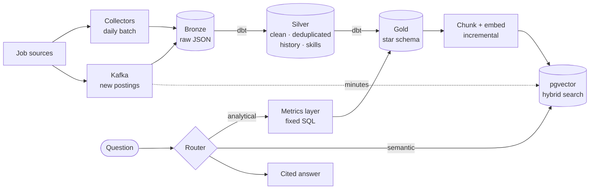

# Job Market Assistant

A data platform and retrieval-augmented generation (RAG) assistant for the data engineering and AI job market in **Hyderabad, Bengaluru and remote roles open to candidates in India**.

It collects job postings every day, models them in a warehouse, and answers natural-language questions about them, with citations:

- **Analytical answers** come from the warehouse, through a fixed metrics layer: "Is demand for Databricks higher in Hyderabad or Bengaluru?"
- **Semantic answers** come from searching posting text: "What do employers mean by 'strong Kafka experience'? Give three examples."
- **Combined answers** do both: "How many remote roles mention LangChain, and what are some examples?"
- It **declines** questions the data can't answer, such as salaries, other cities and predictions.

**Documentation site:** <https://vvanurag.github.io/job-market-assistant/>

## Quick start

```bash
git clone https://github.com/vvanurag/job-market-assistant.git
cd job-market-assistant
make setup        # virtual environment, dependencies, git hooks, .env
make doctor       # checks Python, Docker, DuckDB, Snowflake, Ollama and API keys
make collect bronze dbt-build   # collect postings, load Bronze, build Silver and Gold
make up index     # start the vector database and build the search index
docker compose up -d            # API, Airflow, Kafka and the vector database
```

Then open <http://localhost:8000/docs> to ask questions (`X-API-Key` from `.env`), and <http://localhost:8000/status?key=…> for the health view. The full guide is in [Development Setup](docs/development/setup.md).

---

## Why this project exists

Most RAG demos index a folder of PDFs and stop there. In production, answer quality depends mostly on the data behind the model: whether it's deduplicated, fresh, described by good metadata and kept in sync as sources change. This project builds that data foundation properly, then **measures** how much each data engineering step improves retrieval (the [data-quality experiment](docs/evaluation/results.md#data-quality-experiment)).

## Architecture



| Concern | Choice | Decision record |
|---|---|---|
| Warehouse | Snowflake and DuckDB, with identical results on both (verified table by table) | [ADR-0003](docs/decisions/0003-snowflake-as-primary-warehouse.md), [ADR-0005](docs/decisions/0005-portable-warehouse-layer.md) |
| Transformation | dbt Core: Medallion layers, a star schema, SCD Type 2 history, 147 tests | [Silver](docs/pipeline/silver.md), [Gold](docs/pipeline/gold.md) |
| Orchestration | Apache Airflow 3, one task per dbt model | [ADR-0010](docs/decisions/0010-dbt-in-airflow.md) |
| Streaming | Apache Kafka, as a Lambda speed layer | [ADR-0009](docs/decisions/0009-lambda-architecture-for-streaming.md) |
| Vector store | PostgreSQL + pgvector, hybrid search with Reciprocal Rank Fusion | [ADR-0004](docs/decisions/0004-vector-store-selection.md), [ADR-0007](docs/decisions/0007-chunking-strategy.md) |
| Language models | Groq, Gemini or local Ollama, switched by configuration | [ADR-0006](docs/decisions/0006-llm-provider-strategy.md) |
| Analytics safety | A metrics layer: the model never writes SQL | [ADR-0008](docs/decisions/0008-metrics-layer-not-text-to-sql.md) |
| API | FastAPI: `/ask`, `/search`, `/postings/{id}`, `/match`, `/health`, `/status` | [API](docs/serving/api.md) |
| Delivery | GitHub Actions (lint, secret scan, tests and coverage, dbt build, images), Docker Compose | [Delivery](docs/operations/delivery.md) |

## Results

See [Evaluation Results](docs/evaluation/results.md): routing, analytical accuracy, retrieval, groundedness, refusals, latency, model comparisons and the data-quality experiment, all on a 54-question evaluation set.

## Documentation

| Document | Purpose |
|---|---|
| [Product Requirements](docs/requirements/product_requirements.md) | Vision, goals, users, scope, user stories |
| [Functional](docs/requirements/functional_requirements.md) and [Non-Functional Requirements](docs/requirements/non_functional_requirements.md) | What the system must do, and how well |
| [Data Sources](docs/requirements/data_sources.md) | Sources, fields and compliance checks |
| [Evaluation Plan](docs/requirements/evaluation_plan.md) and [Results](docs/evaluation/results.md) | How quality is measured, and the measurements |
| [Roadmap](docs/roadmap.md) | Delivery phases and exit criteria |
| [Architecture Decisions](docs/decisions/index.md) | Ten decision records |
| [Development Setup](docs/development/setup.md) and [Conventions](docs/development/conventions.md) | Getting started; code and documentation rules |

To browse the documentation locally, run `make docs`.

## Author

Anurag V V
