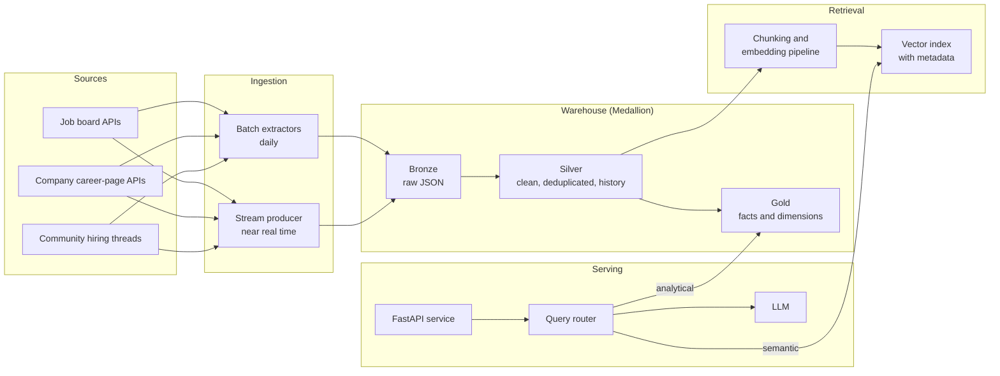

# Job Market Assistant

A data platform and retrieval-augmented generation (RAG) assistant for the data engineering and AI job market in **Hyderabad and Bengaluru, India**.

The system collects job postings from public sources every day, models them in a cloud data warehouse, and answers natural-language questions about them. It combines two kinds of answers:

- **Analytical answers** from SQL over modeled warehouse tables, such as "Which skills grew fastest in data engineering postings over the last 90 days?"
- **Semantic answers** from retrieval over posting text, such as "What do employers mean by 'strong Kafka experience'? Show three examples."

> **Status:** Requirements phase. No code yet. See the [Roadmap](docs/roadmap.md).

---

## Why this project exists

Most RAG demos index a folder of PDFs and stop there. In production, answer quality depends mostly on the data behind the model: whether it is deduplicated, fresh, well described by metadata and kept in sync as sources change. This project builds that data foundation properly and measures how much it improves the assistant's answers.

## Planned architecture



## Planned technology

| Concern | Choice | Decision record |
|---|---|---|
| Warehouse | Snowflake, with DuckDB as a portable second target | [ADR-0003](docs/decisions/0003-snowflake-as-primary-warehouse.md), [ADR-0005](docs/decisions/0005-portable-warehouse-layer.md) |
| Transformation | dbt Core | Planned |
| Orchestration | Apache Airflow (Astro CLI, Cosmos) | Planned |
| Streaming | Apache Kafka | Planned |
| Vector store | pgvector or Qdrant, to be decided | [ADR-0004](docs/decisions/0004-vector-store-selection.md) (proposed) |
| Language models | Local models (Ollama), Google AI Studio (Gemini), Groq Cloud | [ADR-0006](docs/decisions/0006-llm-provider-strategy.md) |
| API | FastAPI, run locally | Planned |
| CI/CD | GitHub Actions | Planned |
| Runtime | Python 3.11+, Docker Compose | Planned |

## Documentation

| Document | Purpose |
|---|---|
| [Product Requirements](docs/requirements/product_requirements.md) | Vision, goals, users, scope, user stories |
| [Functional Requirements](docs/requirements/functional_requirements.md) | What the system must do, by component |
| [Non-Functional Requirements](docs/requirements/non_functional_requirements.md) | Measurable quality targets and service levels |
| [Data Sources](docs/requirements/data_sources.md) | Candidate sources, fields and compliance checks |
| [Evaluation Plan](docs/requirements/evaluation_plan.md) | How answer quality is measured |
| [Roadmap](docs/roadmap.md) | Delivery phases and exit criteria |
| [Architecture Decisions](docs/decisions/index.md) | Record of significant technical decisions |
| [Glossary](docs/glossary.md) | Terms used across the project |

To browse the documentation locally:

```bash
pip install mkdocs-material
mkdocs serve
```

## Author

Anurag V V
