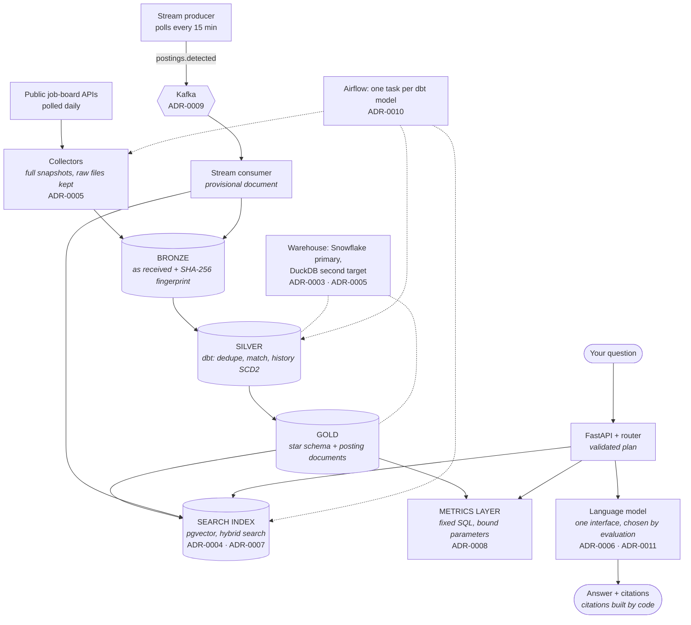
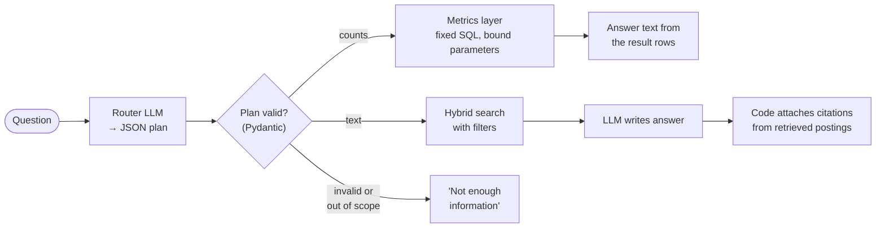

# Architecture Decisions, Explained

This page explains **why the system is built the way it is**. It follows a job posting from the moment it is collected to the moment it appears in a cited answer. At each stage it shows the decision that was made, the options that were rejected, and the trade-off that was accepted.

Each formal decision has its own short record (an **ADR**, architecture decision record) in [Decisions](decisions/index.md). This page joins them into one picture and adds the design choices that shaped the system without needing a record of their own.

!!! tip "How to read each decision"
    Each decision answers four questions: **What was decided?** **Which part of the use case forced it?** **What else was considered?** **What did it cost?** A decision is good when you can still defend the cost.

**Contents**

1. [The use case sets the rules](#1-the-use-case-sets-the-rules)
2. [The data flow, with decisions marked](#2-the-data-flow-with-decisions-marked)
3. [Collecting: snapshots, kept raw](#3-collecting-snapshots-kept-raw)
4. [Storing: one warehouse, kept portable](#4-storing-one-warehouse-kept-portable)
5. [Cleaning and modeling: Medallion layers in dbt](#5-cleaning-and-modeling-medallion-layers-in-dbt)
6. [Searching: pgvector and section-aware chunks](#6-searching-pgvector-and-section-aware-chunks)
7. [Answering: two paths, citations in code](#7-answering-two-paths-citations-in-code)
8. [Running daily: Airflow, one task per model](#8-running-daily-airflow-one-task-per-model)
9. [Going faster: a Lambda speed layer with Kafka](#9-going-faster-a-lambda-speed-layer-with-kafka)
10. [Choosing models: measured, not assumed](#10-choosing-models-measured-not-assumed)
11. [The threads that tie it together](#11-the-threads-that-tie-it-together)
12. [What would change at a larger scale](#12-what-would-change-at-a-larger-scale)

---

## 1. The use case sets the rules

The assistant answers questions about data and AI jobs in Hyderabad, Bengaluru and remote roles open to India. The questions come in two kinds:

| Kind of question | Example | What it needs |
|---|---|---|
| **Counts and trends** | "Which skills do most data engineer jobs ask for?" | Exact numbers from clean, deduplicated tables |
| **What postings say** | "What do employers mean by strong Kafka experience?" | Finding the right passages and summarising them, with sources |

Almost every architectural decision traces back to one of the facts below. When a choice on this page seems odd, look for its row here.

| Fact about the use case | What it forces in the architecture |
|---|---|
| There are **two kinds of question** | Two answer paths: fixed SQL for counts, retrieval-augmented generation (RAG) for text. A router picks one |
| Job boards are **polled**; they return the full list, not changes | Collect complete daily **snapshots** and compare them |
| Postings **close silently** by disappearing | History must be derived from **what is missing** between snapshots, which needs batch processing |
| The same job appears **several times** (reposts, two boards) | Deduplication and cross-source matching before anything is counted or indexed |
| Answers must be **trusted** | Every answer cites real postings; numbers come from SQL, not from the model; quality is **measured** |
| New jobs matter **today**, not tomorrow | A fast path that makes new postings searchable within minutes |
| A **personal project** on a laptop and free tiers | Local Docker services, free models, low idle cost, no vendor lock-in |
| It is a **learning project** | Industry-standard tools (Snowflake, dbt, Airflow, Kafka), used the way companies use them |

The choice of domain is itself a decision. Job postings were chosen over synthetic data, personal notes and financial filings because they have real quality problems that justify each data engineering component, and the answers are useful to the owner ([ADR-0002](decisions/0002-job-market-as-project-domain.md)).

---

## 2. The data flow, with decisions marked

Read from top to bottom. Each box names the main decision at that stage and its record.

There are two routes into the index. The **batch route** (left) is the source of truth and runs once a day. The **speed route** (Kafka) adds brand-new postings within minutes, and the next batch run replaces what it added. Section 9 explains why.

---

## 3. Collecting: snapshots, kept raw

**Decision.** Collectors download each source's **complete** list of jobs every day and store it exactly as received, both as compressed JSON files and as Bronze rows. Each row carries a SHA-256 **fingerprint** of its content, so loading the same batch twice inserts nothing.

**Forced by.** Sources are polled, and postings close by disappearing. You can only notice that something is missing if you kept the full list from the day before.

**Considered.**

| Option | Why not |
|---|---|
| Store only new or changed postings | Saves space, but then a missing posting can't be told apart from one that wasn't collected |
| Clean during collection | Simpler pipeline, but a bug in the cleaning destroys data that can never be downloaded again |

**Cost.** Storage grows with every daily snapshot. At this scale it is a few megabytes a day, and it buys the ability to rebuild every later layer from scratch, in any engine.

> **The principle:** raw data is the one thing you can't rebuild. Keep it unchanged, and make every load idempotent (safe to repeat).

---

## 4. Storing: one warehouse, kept portable

**Decision.** Snowflake is the primary warehouse ([ADR-0003](decisions/0003-snowflake-as-primary-warehouse.md)), and the whole transformation layer must also build on DuckDB, a free local database ([ADR-0005](decisions/0005-portable-warehouse-layer.md)).

**Forced by.** The learning goal calls for a real cloud warehouse. The personal-project budget means the Snowflake trial may end, and that choice was deliberately left open.

**Considered.**

| Option | Why not |
|---|---|
| Use Snowflake fully, decide later | Snowflake-only syntax spreads through the code, and leaving becomes a rewrite |
| Skip Snowflake, use only DuckDB | No lock-in, but loses the cloud-warehouse experience |
| Databricks or PostgreSQL | More setup for a SQL-first project, or not representative of warehouse work |

**How portability is kept, not just promised:**

- Engine-specific SQL (JSON access, regular expressions, string aggregation) lives in a short list of dbt macros, with one version per engine.
- `make compare` builds both warehouses and checks that every table is identical.
- CI builds and tests the dbt project on every push.
- The search index and the API don't depend on the warehouse (sections 6 and 7).

**Cost.** Some convenient Snowflake features need wrappers, and every model is effectively written for two engines. In return, the question "what happens when the trial ends?" has a cheap answer: change one profile.

---

## 5. Cleaning and modeling: Medallion layers in dbt

**Decision.** Data moves through three layers, **Bronze** (raw), **Silver** (clean) and **Gold** (ready to use), and every transformation is a dbt SQL model with tests.

**Forced by.** Duplicates, inconsistent city names, personal data in descriptions and silent closures must all be fixed **once**, before both answer paths read the data. If the search index and the SQL metrics cleaned data separately, they would disagree.

Within Silver, three choices matter most:

| Choice | What was decided | Why |
|---|---|---|
| **History from snapshots** | Each posting's history is rebuilt from Bronze deliveries as an SCD2 table. A posting closes after it is missing from **2** consecutive runs | One missed run is often a source hiccup; two is a real closure. Rebuilding from Bronze means history can be recomputed if the rule changes |
| **Cross-source matching** | The same job on two boards becomes one job when the company, city and title match and the description agrees | Without it, every count is inflated and search returns the same job twice |
| **Rules as data** | City aliases, the 128-skill dictionary, seniority and work-mode rules are dbt **seed** files (CSV), not code | Rules can be read and changed without touching SQL, and the streaming path reuses the same files (section 9) |

Gold is a **star schema**: facts (`fct_postings`, one row per unique job, and `fct_posting_skills`) with dimensions for company, skill, location, date and source. It also publishes `posting_documents`, the text-plus-metadata that the search index reads. Gold is the **only** layer the assistant reads.

**Considered.** Writing transformations in Python instead of dbt would have been more flexible, but loses tests next to the models, lineage, documentation and the two-engine build.

**Cost.** More tables than a quick script would produce. Each one has a declared grain and tests, which is what makes the evaluation numbers trustworthy.

---

## 6. Searching: pgvector and section-aware chunks

**Decision.** The search index is PostgreSQL with the **pgvector** extension, running locally in Docker ([ADR-0004](decisions/0004-vector-store-selection.md)). Postings are split into **section-aware chunks** ([ADR-0007](decisions/0007-chunking-strategy.md)).

**Forced by.** Questions about postings usually include filters ("in Hyderabad, hybrid, still open"), and they mix meaning ("streaming pipelines") with exact terms ("PySpark"). So the index needs metadata filters, vector search and keyword search together.

**Vector store, considered.** The decision came from a spike: the same 12,444 chunks were loaded into two stores and timed.

| Option | Result |
|---|---|
| **pgvector** (chosen) | p95 under 14 ms; hybrid keyword + vector search with filters in **one SQL query**; updates are ordinary transactions |
| Qdrant | Also fast enough, but hybrid search needs a second index and merging in the client, and it is one more system to run |
| Snowflake's vector features | Would tie retrieval to the warehouse whose future is open (section 4) |
| A managed vector service | A vendor and a cost line, unnecessary for local use |

Both local options were about a hundred times inside the latency target, so speed didn't decide. **Simplicity and SQL did.**

**Chunking, considered.** A whole posting as one vector blurs every topic together. Fixed-size windows cut across sections. Section-aware chunks keep one topic per chunk: splits happen at headings such as "Requirements", legal boilerplate is dropped, and chunks are capped at 1,200 characters with a 200-character overlap. Each chunk starts with "Title at Company (City)", so a chunk read alone still says which job it is from.

**Incremental by design.** Each build re-embeds only documents whose content hash or chunker version changed, so a daily refresh takes seconds, not a full rebuild.

**Cost.** The chunking rules are tuned to job postings, and changing any of them re-embeds everything. That is why the chunker carries a version number.

---

## 7. Answering: two paths, citations in code

**Decision.** A FastAPI service sends each question to a **router**, a language model call that returns a JSON plan. The plan is validated before anything runs. Counts go to a **metrics layer** of fixed SQL ([ADR-0008](decisions/0008-metrics-layer-not-text-to-sql.md)). Text questions go to hybrid search and then to the model. **Citations are built by code** from the passages actually retrieved.

**Forced by.** Answers must be trusted, and the model must never be able to change data.

**Considered.**

| Option | Why not |
|---|---|
| **Text-to-SQL** (the model writes SQL) | Flexible, but a validator must parse arbitrary SQL, a prompt injection can still produce misleading queries, and every number depends on the model writing correct joins |
| A semantic-layer product | The right idea, but an extra service for five metrics |
| Let the model write citations | Models invent source numbers; code can't |

The model only chooses one of five metrics (`top_skills`, `skill_trend`, `compare_cities`, `count_jobs`, `top_companies`) and fills in typed filters. User text only ever becomes a bound parameter, and the API reads Gold through a read-only role. Tests send hostile plans to prove it.

**Model access through one interface.** Every model call goes through a single module, so Groq, Gemini and local Ollama models are interchangeable by configuration ([ADR-0006](decisions/0006-llm-provider-strategy.md)). A provider retiring a model, which happened during this project, is a settings change, not a rewrite.

**Cost.** A new kind of analytical question needs a new metric, written and tested in code. That is slower than text-to-SQL, but every number is exact by construction.

---

## 8. Running daily: Airflow, one task per model

**Decision.** An Airflow DAG runs collection, every dbt model and the index refresh each day. It creates **one task per dbt model** by reading dbt's `manifest.json` ([ADR-0010](decisions/0010-dbt-in-airflow.md)).

**Forced by.** Daily snapshots only work if they happen every day, without anyone remembering. A failure must be retryable on its own, and a failed test must stop bad data from reaching the assistant.

**Considered.**

| Option | Why not |
|---|---|
| One `dbt build` task | A failure in one model reruns everything, and the run history shows one opaque box |
| Astronomer Cosmos | Does the same, but adds a dependency that must track both Airflow and dbt versions |
| A small manifest reader (chosen) | About 20 lines, no extra dependency, and new models appear as tasks automatically |

Each task runs `dbt build --select <model>`, which runs the model **and its tests**. The index refresh, the step that publishes Gold to the assistant, runs only when every model task succeeded. The project runs in its own virtual environment inside the Airflow image, so Airflow's and dbt's dependencies never clash.

**Cost.** dbt parses the project once per task, a few seconds each. At about 18 models that's fine.

---

## 9. Going faster: a Lambda speed layer with Kafka

**Decision.** The daily batch stays the source of truth. A separate **speed layer** detects new postings every 15 minutes, publishes them to a Kafka topic, and a consumer makes them searchable straight away. The next batch run replaces them with the fully cleaned version ([ADR-0009](decisions/0009-lambda-architecture-for-streaming.md)).

**Forced by.** New jobs should be searchable within an hour, but the batch only refreshes once a day. At the same time, closures can only be detected by comparing full snapshots, which a stream can't do.

**Considered.**

| Option | Why not |
|---|---|
| **Kappa** (everything through Kafka) | All dbt models would be rewritten as stream processors, losing the two-warehouse layer, and closures would still need snapshot comparison |
| **Lambda** (chosen) | Batch stays simple and tested; the stream only adds new postings |
| Run the batch every 15 minutes | Rebuilds every model for a handful of new jobs, and makes history count runs that are really just top-ups |

**How the two layers stay consistent:**

- **Same key.** Both layers identify a posting by `posting_key = md5(source | posting id)`, so a streamed posting and its batch copy are one posting.
- **Same rules.** The consumer builds its provisional document from the **same seed files** as dbt.
- **Batch wins.** A provisional document is marked as such, and the next index build always replaces it. The stream never overwrites a posting the batch already indexed.
- **History ignores the stream.** Stream batches contain only new postings, so the history model doesn't count them as daily runs.
- **At-least-once, safely.** The consumer commits its Kafka offset only after the posting is stored and indexed. Processing is idempotent, so a repeated event changes nothing.

**Cost.** Some rules exist twice, in SQL and in Python. A streamed posting appears in **search** within about 15 seconds but in **counts** only after the next batch, so Gold remains the single tested view.

---

## 10. Choosing models: measured, not assumed

**Decision.** Models were chosen by running a 54-question evaluation set against each candidate, scored by a judge model from a different provider ([ADR-0011](decisions/0011-model-selection.md)).

| Role | Choice | Deciding numbers |
|---|---|---|
| Answering (default) | Groq `gpt-oss-120b` | Analytical 94%, groundedness 98%, citations 99%, p95 1.9 s |
| Fallback | Gemini `gemini-3.5-flash-lite` | Highest quality, but p95 6.5 s |
| Embeddings | Local `nomic-embed-text` | Matched a larger model at less than half the indexing time |

**Forced by.** "Trusted answers" means nothing unless it is measured. The same evaluation also measured what the data engineering contributed:

| Step added | Recall@5 |
|---|---|
| Raw postings, duplicates included | 62% |
| + Deduplication | 64% |
| + Metadata filters | **94%** |
| + Hybrid keyword search | 95% |

The biggest gain came from clean, well-labelled data, not from the model. That result is the strongest argument for every decision in sections 3 to 6.

---

## 11. The threads that tie it together

The decisions above were made one at a time, but they rest on a few shared ideas:

| Idea | Where it shows up |
|---|---|
| **Keep raw data and rebuild from it** | Raw files and fingerprints (3); history rebuilt from Bronze (5); provisional documents replaced by batch (9) |
| **One key for one job** | `posting_key` in Silver, Gold, the index and the Kafka topic |
| **Rules live in one place** | Seed files used by dbt and the stream consumer |
| **Configuration over code** | Warehouse profile (4), model provider and embedding model (7, 10) |
| **The model chooses; code executes** | Router plan validated (7); fixed SQL metrics (7); citations from code (7) |
| **Test what you can, measure the rest** | dbt tests and two-engine comparison (4, 5); evaluation set (10); CI on every push |
| **Measure before deciding** | Vector-store spike (6); model and embedding comparisons (10) |

---

## 12. What would change at a larger scale

Every decision here fits a personal project with thousands of postings. These are the points where it would be worth revisiting:

| Decision | Revisit when |
|---|---|
| pgvector on one machine | The index reaches many millions of chunks, or many users search at once |
| One Airflow task per dbt model | The project grows to hundreds of models (dbt parse time per task adds up) |
| Lambda with rules in two languages | The stream must also produce analytics, not just search, within minutes |
| A five-metric layer | Users ask many kinds of analytical question (a semantic-layer product starts to pay off) |
| Free-tier models | Usage exceeds about three questions a minute (Groq's free quota) |
| Snowflake trial | The trial ends: switch the profile to DuckDB, or continue on a paid account |

### All decision records

| Record | Decision |
|---|---|
| [ADR-0001](decisions/0001-record-architecture-decisions.md) | Record decisions as short, numbered files |
| [ADR-0002](decisions/0002-job-market-as-project-domain.md) | Job postings as the project domain |
| [ADR-0003](decisions/0003-snowflake-as-primary-warehouse.md) | Snowflake as the primary warehouse |
| [ADR-0004](decisions/0004-vector-store-selection.md) | PostgreSQL with pgvector as the search index |
| [ADR-0005](decisions/0005-portable-warehouse-layer.md) | Keep the warehouse layer portable (DuckDB as second target) |
| [ADR-0006](decisions/0006-llm-provider-strategy.md) | One interface for all model providers |
| [ADR-0007](decisions/0007-chunking-strategy.md) | Section-aware chunking |
| [ADR-0008](decisions/0008-metrics-layer-not-text-to-sql.md) | A metrics layer instead of generated SQL |
| [ADR-0009](decisions/0009-lambda-architecture-for-streaming.md) | Lambda architecture for streaming |
| [ADR-0010](decisions/0010-dbt-in-airflow.md) | dbt in Airflow, one task per model |
| [ADR-0011](decisions/0011-model-selection.md) | Model selection by evaluation |
