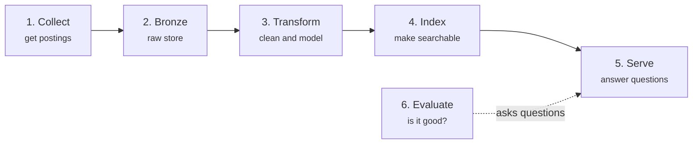
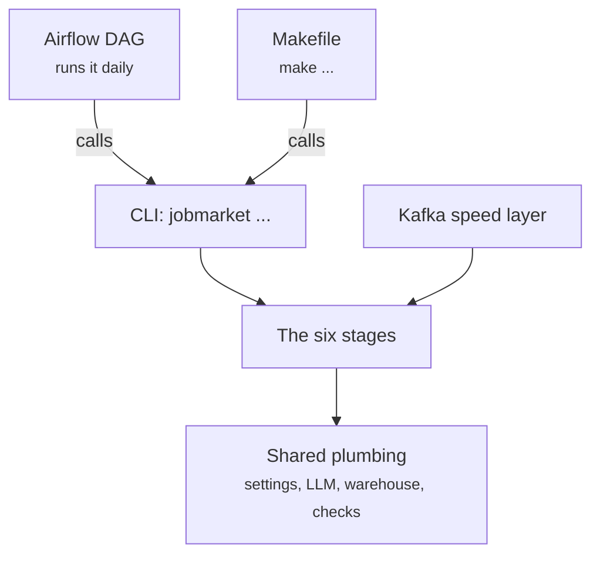

# Code Map

This page is the starting point for reading the source code. It names the **main pieces** of the project, shows how they connect, and tells you which folder holds each one. Each piece will get its own page under this section, going down to individual files.

The project is a **pipeline with six stages**. Data moves through them in order, and a few helper pieces sit around the outside. Every file in the repository belongs either to one stage or to one of those helper pieces.

---

## The spine: how data flows

| # | Piece | What it does | Where it lives | Concept page |
|---|---|---|---|---|
| 1 | **Collect** | Downloads job postings from Greenhouse boards and saves each one as a raw JSON file | [`src/jobmarket/ingestion/`][ingestion], [`config/greenhouse_boards.csv`][boards]; output goes to `data/bronze/` | [Data Sources](../requirements/data_sources.md) |
| 2 | **Bronze** | Loads those raw files into a warehouse table without changing them (DuckDB locally, Snowflake optionally) | [`src/jobmarket/bronze/`][bronze] | [Bronze Layer](../pipeline/bronze.md) |
| 3 | **Transform** | dbt (SQL) cleans the data and builds the analysis tables: staging → silver (deduplicated, personal data removed, skills, seniority and work mode inferred) → gold (facts and dimensions) | [`transform/`][transform], all SQL, no Python | [Silver](../pipeline/silver.md), [Gold](../pipeline/gold.md) |
| 4 | **Index** | Splits gold postings into chunks, turns them into vectors and stores them in pgvector for hybrid search | [`src/jobmarket/index/`][index] | [Retrieval index](../pipeline/retrieval_index.md) |
| 5 | **Serve** | A FastAPI web service: `/search`, `/ask` (answers from a language model, with sources), `/match` (a resume against open jobs), `/postings`, `/status` | [`src/jobmarket/api/`][api] | [API](../serving/api.md) |
| 6 | **Evaluate** | Runs a fixed set of questions against the assistant, has a language model grade the answers, and compares the scores with the accepted run | [`src/jobmarket/evaluation/`][evaluation], [`eval/`][eval] (questions and results) | [Results](../evaluation/results.md) |

### What is inside each stage

| Stage | Main files | Role of each file |
|---|---|---|
| Collect | [`greenhouse.py`][greenhouse] | Calls the Greenhouse API for each board and writes one JSON file per posting |
| Bronze | [`loader.py`][loader], [`snowflake_loader.py`][sfloader] | Load raw files into DuckDB, or into Snowflake |
| Transform | [`models/staging/`][staging], [`models/silver/`][silver], [`models/gold/`][gold], [`seeds/`][seeds], [`macros/`][macros], [`tests/`][dbttests] | One SQL file per table. Seeds are small lookup tables (skills, city names, seniority rules). Macros are reusable SQL snippets. Tests check rules across tables |
| Index | [`chunking.py`][chunking], [`build.py`][build], [`store.py`][store] | Split text into passages; build or refresh the index; read and write pgvector |
| Serve | [`app.py`][app], [`assistant.py`][assistant], [`metrics.py`][metrics], [`match.py`][match], [`status.py`][status], [`logs.py`][logs] | Routes; text answers with sources; questions about numbers; resume matching; the status page; request logs |
| Evaluate | [`runner.py`][runner], [`experiment.py`][experiment], [`report.py`][report] | Run the question set; compare models and settings; write the results report |

---

## The pieces around the spine

| Piece | What it does | Where it lives | Concept page |
|---|---|---|---|
| **Command line (CLI)** | How every stage is started. Each stage has a command: `jobmarket collect`, `bronze`, `index`, `eval`, `ops`, `stream` | [`src/jobmarket/cli.py`][cli] | [Setup](../development/setup.md) |
| **Makefile** | Short names for common tasks. Most targets call the CLI | [`Makefile`][makefile] | [Setup](../development/setup.md) |
| **Orchestration** | An Airflow DAG that runs stages 1 to 4 every day by calling the same CLI commands: collect → bronze → dbt → index, then a freshness check and a run record | [`orchestration/dags/jobmarket_daily.py`][dag] | [Orchestration](../operations/orchestration.md) |
| **Streaming** | A Kafka "speed layer": a fast side path for new postings that runs next to the daily batch | [`src/jobmarket/streaming.py`][streaming] | [Streaming](../operations/streaming.md) |
| **Shared plumbing** | Code every stage uses (see below) | `src/jobmarket/*.py` | — |
| **Infrastructure** | Docker services (vectordb, api, airflow, kafka) and the Snowflake setup script | [`docker-compose.yml`][compose], [`infra/snowflake/`][infra] | [Delivery](../operations/delivery.md), [Snowflake](../pipeline/snowflake.md) |
| **Tests** | Python tests for each module, with small sample postings | [`tests/`][tests] | [Conventions](../development/conventions.md) |
| **Docs** | This website. `docs/` is the source, `site/` is the built output | [`docs/`][docs] | — |

### Shared plumbing

| File | What it does |
|---|---|
| [`settings.py`][settings] | Reads configuration from `.env` |
| [`llm.py`][llm] | One wrapper for calling the language model providers (Groq, Gemini, Ollama) |
| [`warehouse.py`][warehouse] | Connects to DuckDB or Snowflake |
| [`portability.py`][portability] | Checks that DuckDB and Snowflake produce identical Silver and Gold tables |
| [`skills.py`][skills] | Finds skills in text using the same skill list and rule as dbt, so a resume and a posting are read the same way |
| [`checks.py`][checks] | The `jobmarket doctor` environment checks |
| [`ops.py`][ops] | Freshness checks, alerts and run records |

---

## Suggested reading order

Follow the data:

1. **Collect and Bronze**: where the data comes from
2. **Transform (dbt)**: the largest piece by logic, where the data gets its meaning
3. **Index**: chunking and vector search
4. **Serve**: the API, and how `/ask` turns a question into an answer with sources
5. **Evaluate**: how quality is measured
6. **Orchestration and Streaming**: how it all runs without you

## Related pages

- [How Data Moves](../data-movement.md): where the data is at each moment, and which program moves it.
- [How the Pieces Operate Together](../how-it-operates.md): the same system seen as batch and speed layers.
- [User's Guide](../guide.md): the system explained without code.

[ingestion]: https://github.com/vvanurag/job-market-assistant/tree/main/src/jobmarket/ingestion
[boards]: https://github.com/vvanurag/job-market-assistant/blob/main/config/greenhouse_boards.csv
[bronze]: https://github.com/vvanurag/job-market-assistant/tree/main/src/jobmarket/bronze
[transform]: https://github.com/vvanurag/job-market-assistant/tree/main/transform
[index]: https://github.com/vvanurag/job-market-assistant/tree/main/src/jobmarket/index
[api]: https://github.com/vvanurag/job-market-assistant/tree/main/src/jobmarket/api
[evaluation]: https://github.com/vvanurag/job-market-assistant/tree/main/src/jobmarket/evaluation
[eval]: https://github.com/vvanurag/job-market-assistant/tree/main/eval
[greenhouse]: https://github.com/vvanurag/job-market-assistant/blob/main/src/jobmarket/ingestion/greenhouse.py
[loader]: https://github.com/vvanurag/job-market-assistant/blob/main/src/jobmarket/bronze/loader.py
[sfloader]: https://github.com/vvanurag/job-market-assistant/blob/main/src/jobmarket/bronze/snowflake_loader.py
[staging]: https://github.com/vvanurag/job-market-assistant/tree/main/transform/models/staging
[silver]: https://github.com/vvanurag/job-market-assistant/tree/main/transform/models/silver
[gold]: https://github.com/vvanurag/job-market-assistant/tree/main/transform/models/gold
[seeds]: https://github.com/vvanurag/job-market-assistant/tree/main/transform/seeds
[macros]: https://github.com/vvanurag/job-market-assistant/tree/main/transform/macros
[dbttests]: https://github.com/vvanurag/job-market-assistant/tree/main/transform/tests
[chunking]: https://github.com/vvanurag/job-market-assistant/blob/main/src/jobmarket/index/chunking.py
[build]: https://github.com/vvanurag/job-market-assistant/blob/main/src/jobmarket/index/build.py
[store]: https://github.com/vvanurag/job-market-assistant/blob/main/src/jobmarket/index/store.py
[app]: https://github.com/vvanurag/job-market-assistant/blob/main/src/jobmarket/api/app.py
[assistant]: https://github.com/vvanurag/job-market-assistant/blob/main/src/jobmarket/api/assistant.py
[metrics]: https://github.com/vvanurag/job-market-assistant/blob/main/src/jobmarket/api/metrics.py
[match]: https://github.com/vvanurag/job-market-assistant/blob/main/src/jobmarket/api/match.py
[status]: https://github.com/vvanurag/job-market-assistant/blob/main/src/jobmarket/api/status.py
[logs]: https://github.com/vvanurag/job-market-assistant/blob/main/src/jobmarket/api/logs.py
[runner]: https://github.com/vvanurag/job-market-assistant/blob/main/src/jobmarket/evaluation/runner.py
[experiment]: https://github.com/vvanurag/job-market-assistant/blob/main/src/jobmarket/evaluation/experiment.py
[report]: https://github.com/vvanurag/job-market-assistant/blob/main/src/jobmarket/evaluation/report.py
[cli]: https://github.com/vvanurag/job-market-assistant/blob/main/src/jobmarket/cli.py
[makefile]: https://github.com/vvanurag/job-market-assistant/blob/main/Makefile
[dag]: https://github.com/vvanurag/job-market-assistant/blob/main/orchestration/dags/jobmarket_daily.py
[streaming]: https://github.com/vvanurag/job-market-assistant/blob/main/src/jobmarket/streaming.py
[compose]: https://github.com/vvanurag/job-market-assistant/blob/main/docker-compose.yml
[infra]: https://github.com/vvanurag/job-market-assistant/tree/main/infra/snowflake
[tests]: https://github.com/vvanurag/job-market-assistant/tree/main/tests
[docs]: https://github.com/vvanurag/job-market-assistant/tree/main/docs
[settings]: https://github.com/vvanurag/job-market-assistant/blob/main/src/jobmarket/settings.py
[llm]: https://github.com/vvanurag/job-market-assistant/blob/main/src/jobmarket/llm.py
[warehouse]: https://github.com/vvanurag/job-market-assistant/blob/main/src/jobmarket/warehouse.py
[portability]: https://github.com/vvanurag/job-market-assistant/blob/main/src/jobmarket/portability.py
[skills]: https://github.com/vvanurag/job-market-assistant/blob/main/src/jobmarket/skills.py
[checks]: https://github.com/vvanurag/job-market-assistant/blob/main/src/jobmarket/checks.py
[ops]: https://github.com/vvanurag/job-market-assistant/blob/main/src/jobmarket/ops.py
