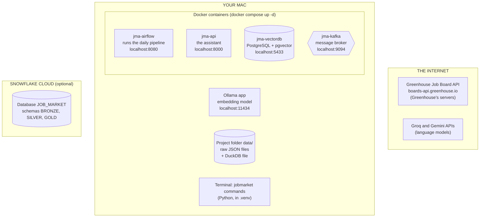
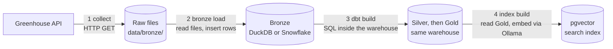
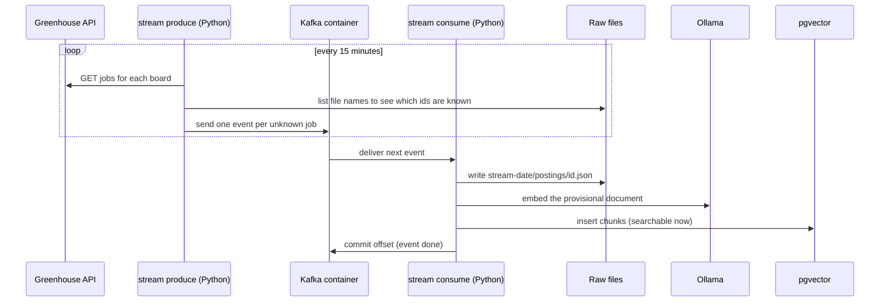
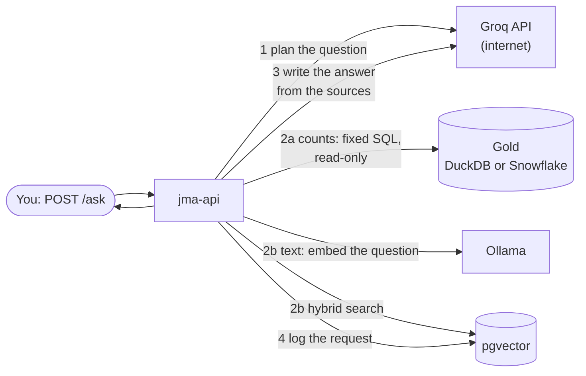

# How Data Moves

This page answers two questions: **where is the data at each moment**, and **which program moves it to the next place**.

Data never moves by itself. Databases, Kafka and folders only **hold** data. Every arrow on this page is a program you can name, started by you or by Airflow, with source code you can open.

**Contents**

1. [Where things run](#1-where-things-run)
2. [Where data rests](#2-where-data-rests)
3. [The programs that move it](#3-the-programs-that-move-it)
4. [The daily batch journey, step by step](#4-the-daily-batch-journey-step-by-step)
5. [The streaming journey](#5-the-streaming-journey)
6. [The question journey (reading only)](#6-the-question-journey-reading-only)
7. [Who starts what](#7-who-starts-what)
8. [Common misunderstandings](#8-common-misunderstandings)

---

## 1. Where things run

The system spans three places: **the internet**, **your Mac**, and **Snowflake's cloud**. On your Mac, some programs run directly and some run inside Docker containers.



Two details explain a lot of the behaviour:

- **The Airflow container sees the project folder.** `docker-compose.yml` mounts it at `/opt/jobmarket`, so files Airflow's tasks write to `data/` appear in your project folder, and the reverse.
- **The API container mounts `data/` read-only.** It can read the DuckDB file but never change it.

---

## 2. Where data rests

These are the only places data is ever stored. Everything else just passes through memory.

| Store | What it is | Location | What's in it |
|---|---|---|---|
| **Raw files** | Plain JSON files on disk | `data/bronze/<source>/<batch>/postings/<id>.json` | One file per posting, exactly as the API returned it. A *batch* is one collection run, such as `2026-11-06` or `stream-2026-11-06` |
| **DuckDB** | A database stored in **one file** | `data/dev/jobmarket.duckdb` | Schemas `bronze`, `silver`, `gold`. The daily default warehouse |
| **Snowflake** | A cloud warehouse | Database `JOB_MARKET` | The same three schemas, plus the stage `BRONZE.RAW_FILES` holding copies of the raw files |
| **pgvector** | PostgreSQL in Docker | Container `jma-vectordb` | The search index (`postings` and `chunks` tables), plus request logs, run records, alerts and stream events in `public` |
| **Kafka** | A message log in Docker | Container `jma-kafka`, topic `postings.detected` | Short "new posting detected" events. Not the system of record |
| **Stream state** | A small JSON file | `data/stream/published_ids.json` | Ids the producer has already sent, so it doesn't send them twice |

`data/` is never committed to Git. It exists only on your machine.

---

## 3. The programs that move it

Every arrow in the system is one of these. Most are subcommands of the project's own command-line tool, `jobmarket`, defined in [cli.py](https://github.com/vvanurag/job-market-assistant/blob/main/src/jobmarket/cli.py).

| # | Program | Reads from | Writes to | Code |
|---|---|---|---|---|
| 1 | `jobmarket collect greenhouse` | Greenhouse API (HTTP) | Raw files | [ingestion/greenhouse.py](https://github.com/vvanurag/job-market-assistant/blob/main/src/jobmarket/ingestion/greenhouse.py) |
| 2 | `jobmarket bronze load` | Raw files | DuckDB `bronze.raw_postings` | [bronze/loader.py](https://github.com/vvanurag/job-market-assistant/blob/main/src/jobmarket/bronze/loader.py) |
| 2b | `jobmarket bronze load --target snowflake` | Raw files | Snowflake stage, then `BRONZE.RAW_POSTINGS` | [bronze/snowflake_loader.py](https://github.com/vvanurag/job-market-assistant/blob/main/src/jobmarket/bronze/snowflake_loader.py) |
| 3 | `dbt build` | Bronze tables | Silver and Gold tables, **in the same warehouse** | [transform/models/](https://github.com/vvanurag/job-market-assistant/tree/main/transform/models) |
| 4 | `jobmarket index build` | Gold `posting_documents`; Ollama for embeddings | pgvector | [index/build.py](https://github.com/vvanurag/job-market-assistant/blob/main/src/jobmarket/index/build.py) |
| 5 | `jobmarket stream produce` | Greenhouse API; raw-file names | Kafka topic | [streaming.py](https://github.com/vvanurag/job-market-assistant/blob/main/src/jobmarket/streaming.py) |
| 6 | `jobmarket stream consume` | Kafka topic | Raw files **and** pgvector | [streaming.py](https://github.com/vvanurag/job-market-assistant/blob/main/src/jobmarket/streaming.py) |
| 7 | The API (`jma-api`) | pgvector, Gold (read-only), model APIs | pgvector request log only | [api/](https://github.com/vvanurag/job-market-assistant/tree/main/src/jobmarket/api) |

dbt is the odd one out: **it doesn't move data between systems.** It sends SQL to the warehouse, and the warehouse creates Silver and Gold tables from Bronze tables inside itself. Data enters a warehouse only through program 2 or 2b.

---

## 4. The daily batch journey, step by step



### Step 1: Collect (internet → files)

`jobmarket collect greenhouse` reads the list of company boards from `config/greenhouse_boards.csv`. For each board it makes **one** HTTP request, `GET /v1/boards/<company>/jobs?content=true`, keeps jobs in the target cities, and writes each one as its own file:

```
data/bronze/greenhouse/2026-11-06/postings/7712345.json   ← one job, exactly as received
data/bronze/greenhouse/2026-11-06/_run.json               ← which boards succeeded or failed
```

- **Why files first:** if a later step has a bug, the raw data is still there. Nothing can download yesterday's data again.
- **Failures:** a failing board is recorded and skipped, and the others continue. Running the same batch again rewrites the same files, so it can't create duplicates.
- **Code:** `fetch_board()` in [greenhouse.py](https://github.com/vvanurag/job-market-assistant/blob/main/src/jobmarket/ingestion/greenhouse.py) makes the request.

### Step 2: Load Bronze (files → warehouse)

`jobmarket bronze load` finds **every** batch folder under `data/bronze/`, including streamed ones (`discover_batches()` in [loader.py](https://github.com/vvanurag/job-market-assistant/blob/main/src/jobmarket/bronze/loader.py)). For each batch it:

1. Reads the files and computes a SHA-256 **fingerprint** of each file's text.
2. Compares them with what Bronze already holds for that batch: new, identical, or changed.
3. Inserts **only new rows**. Identical rows are skipped, and changed rows are reported but never overwritten.
4. Records the counts in `bronze.load_runs`.

For **Snowflake**, the loader first uploads the files with `PUT` into the stage `BRONZE.RAW_FILES`, then inserts from the stage, with the same fingerprints. It connects as the role `JMA_INGEST`, which can write Bronze and nothing else.

### Step 3: Transform (Bronze → Silver → Gold, inside the warehouse)

`dbt build` reads the SQL files in `transform/models/`, fills in the right macros for the engine, and sends each one to the warehouse as `CREATE TABLE … AS SELECT …`. The warehouse does the work, and dbt then runs each model's tests.

| Folder | Builds | Main jobs |
|---|---|---|
| `models/staging/` | `stg_postings` | One shape for every source |
| `models/silver/` | `slv_postings`, `slv_posting_jobs`, `slv_posting_history`, `slv_posting_skills`, `slv_posting_attributes` | Keep latest versions, link reposts, match jobs across sources, compare runs to find changes and closures, find skills, seniority and work mode |
| `models/gold/` | `fct_postings`, `fct_posting_skills`, `dim_*`, `posting_documents`, `posting_versions` | Tables for counting, and documents for the search index |

`--target dev` builds in DuckDB, and `--target snowflake` builds in Snowflake (as the role `JMA_TRANSFORM`). The SQL is the same for both.

### Step 4: Index (Gold → pgvector)

`jobmarket index build` connects to the warehouse **read-only** and runs `select … from gold.posting_documents` (`read_gold()` in [warehouse.py](https://github.com/vvanurag/job-market-assistant/blob/main/src/jobmarket/warehouse.py)). For each job whose text has changed, it:

1. Splits the description into chunks ([chunking.py](https://github.com/vvanurag/job-market-assistant/blob/main/src/jobmarket/index/chunking.py)).
2. Sends the chunks over HTTP to **Ollama** on your Mac, which returns 768 numbers per chunk.
3. Writes the chunks and their vectors into pgvector.

Unchanged jobs only get their metadata refreshed (for example, a status change to closed). Jobs no longer in Gold are deleted.

---

## 5. The streaming journey

The stream adds **new** postings between daily runs. Kafka sits in the middle as a hand-off point between two Python programs.



- **The producer** ([`produce_once()`](https://github.com/vvanurag/job-market-assistant/blob/main/src/jobmarket/streaming.py)) does the same HTTP request as the collector. A job id is "new" if no Bronze file has that name and the producer hasn't sent it before. Each new job becomes a JSON event, sent with the `confluent-kafka` library to `localhost:9094`.
- **Kafka** only stores the events in order, in its Docker volume `kafka-data`.
- **The consumer** ([`handle_event()`](https://github.com/vvanurag/job-market-assistant/blob/main/src/jobmarket/streaming.py)) reads each event and does two things:
    1. It writes the job as a raw file in batch `stream-<date>`, in exactly the collector's format.
    2. It builds a quick, *provisional* search document and indexes it.

**How streamed data reaches the warehouse:** not through Kafka. The next morning, step 2 of the batch finds the `stream-<date>` folder like any other batch and loads it. From then on, the streamed posting travels the normal batch path, and its batch version replaces the provisional one in the index.

---

## 6. The question journey (reading only)

Answering a question **reads** data and writes only a log row.



The API reads Gold as `JMA_SERVE` on Snowflake, which can read Gold and nothing else, or reads the DuckDB file through a read-only mount. **Nothing in the question path can change the warehouse.** The full walk-through of this path is on the [API](serving/api.md) page.

---

## 7. Who starts what

| Program | Started by | When |
|---|---|---|
| Docker containers | You: `docker compose up -d` | Once; they keep running |
| Ollama | You (macOS app) | Once; it keeps running |
| collect → bronze load → dbt → index build | **Airflow** (DAG `jobmarket_daily`) | Every day at 06:00 IST, once the DAG is turned on |
| Snowflake load and build | Airflow, only if `JOBMARKET_DAG_SNOWFLAKE=true`; otherwise you, with `make bronze-snowflake` and `make dbt-build-snowflake` | Off by default, to save credits |
| stream produce / consume | You, in two terminals | Only while you want the fast path |
| The API | Docker (`jma-api`) | Always on while the containers run |

Each Airflow task is a shell command running the same `jobmarket` or `dbt` command you could type yourself (see `BashOperator` in [jobmarket_daily.py](https://github.com/vvanurag/job-market-assistant/blob/main/orchestration/dags/jobmarket_daily.py)). **Airflow adds the schedule, the order, retries and alerts, not new logic.**

---

## 8. Common misunderstandings

| Misunderstanding | What actually happens |
|---|---|
| "Kafka fetches the job data." | Kafka fetches nothing. The Python producer calls the API and **sends** events to Kafka |
| "Kafka pushes to Snowflake." | Nothing reads Kafka except the consumer, which writes files and the index. Files reach Snowflake through the Bronze loader |
| "dbt moves data into the warehouse." | dbt only sends SQL. Data enters a warehouse through the Bronze loader; dbt reshapes it inside |
| "Airflow processes the data." | Airflow only starts commands in order and retries them. The commands do the work |
| "The APIs run on my machine." | The job APIs and the model APIs run on their companies' servers. Your machine runs Ollama, the containers and the Python commands |
| "Bronze, Silver and Gold are separate databases." | They are three schemas inside one warehouse (DuckDB or Snowflake). Raw files on disk are the copy of Bronze |
| "The search index is in Snowflake." | It's in pgvector, a separate PostgreSQL container, so search doesn't depend on the warehouse |

### Try it: watch the data move

```bash
docker compose up -d                                   # start the containers
.venv/bin/jobmarket collect greenhouse                 # 1: internet → files
ls data/bronze/greenhouse/                             #    a new batch folder appears
.venv/bin/jobmarket bronze load                        # 2: files → DuckDB Bronze
.venv/bin/jobmarket bronze status                      #    rows inserted / unchanged per batch
make dbt-build                                         # 3: Bronze → Silver → Gold
.venv/bin/jobmarket index build                        # 4: Gold → pgvector
.venv/bin/jobmarket index search "strong Kafka experience"
```

## Related pages

- [How the Pieces Operate Together](how-it-operates.md): the same system as Lambda layers.
- [Bronze](pipeline/bronze.md), [Silver](pipeline/silver.md), [Gold](pipeline/gold.md), [Running on Snowflake](pipeline/snowflake.md), [Retrieval index](pipeline/retrieval_index.md).
- [Orchestration](operations/orchestration.md) and [Streaming](operations/streaming.md).
