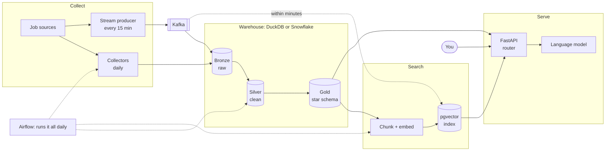
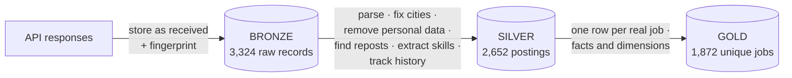
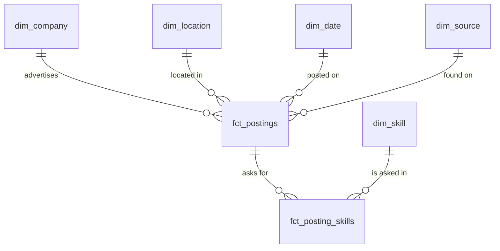
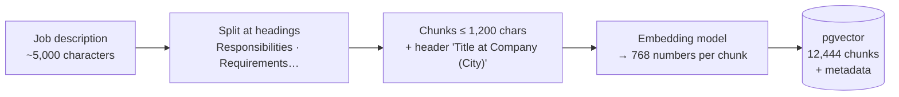
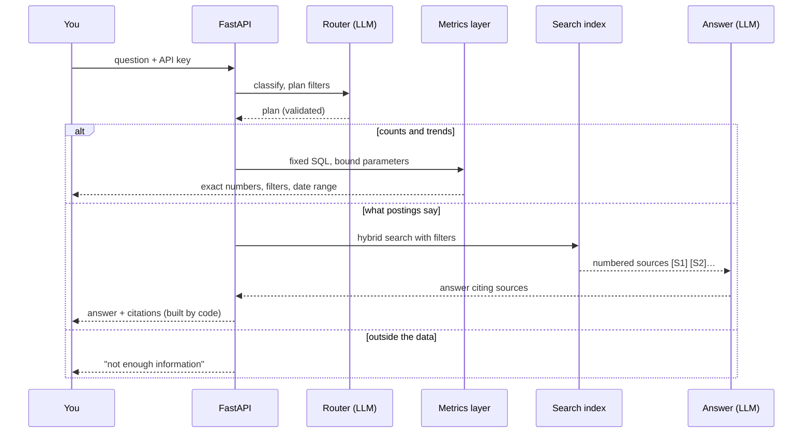
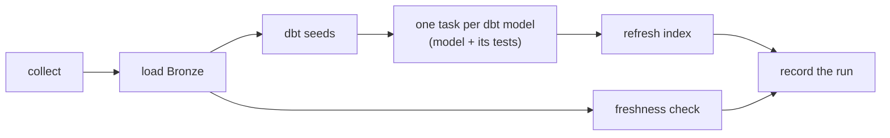
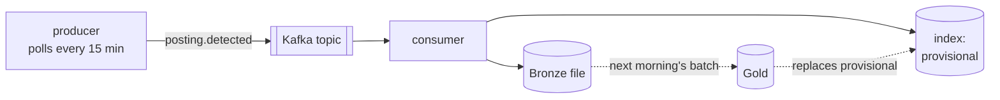

# User's Guide

A plain explanation of the Job Market Assistant: what it's for, how the system fits together, how data flows through it, how to use it, and what building it teaches a beginner data engineer.

For the history of how it was built, read [The Story of the Project](story.md).

## Contents

- [Part 1: The use case](#part-1-the-use-case)
- [Part 2: The system at a glance](#part-2-the-system-at-a-glance)
- [Part 3: The data pipeline: Bronze, Silver, Gold](#part-3-the-data-pipeline-bronze-silver-gold)
- [Part 4: The search index](#part-4-the-search-index)
- [Part 5: How a question gets answered](#part-5-how-a-question-gets-answered)
- [Part 6: Keeping it running](#part-6-keeping-it-running)
- [Part 7: Knowing it works](#part-7-knowing-it-works)
- [Part 8: Using it day to day](#part-8-using-it-day-to-day)
- [Part 9: Lessons for a beginner data engineer](#part-9-lessons-for-a-beginner-data-engineer)

---

## Part 1: The use case

### The problem

Someone moving into data engineering or AI wants to know three things: **which skills employers want**, **how demand is changing**, and **which open roles fit them**. The answers are scattered across hundreds of postings that are duplicated, unstructured, and quickly out of date.

### What the assistant does

It collects data and AI job postings for **Hyderabad, Bengaluru and remote roles open to candidates in India**, cleans and models them, and answers questions in plain English:

| Kind of question | Example | Answered from |
|---|---|---|
| Counts, rankings, trends | "Is demand for Databricks higher in Hyderabad or Bengaluru?" | The warehouse (SQL) |
| What postings say | "What do employers mean by strong Kafka experience?" | Searching posting text, with citations |
| Both | "How many remote roles mention LangChain, and what are some examples?" | Both, combined |
| Outside the data | "What do prompt engineers earn on Mars?" | Politely declined |
| Personal fit | Upload a resume: best-matching open roles and missing skills | Skills extracted locally |

Every answer says what it's based on: numbers state their filters and date range, and text answers cite the postings they used.

## Part 2: The system at a glance



| Piece | What it is | Why it's there |
|---|---|---|
| **Collectors** | Python code that calls job-source APIs | Fetch postings safely: retries, rate limits, logs |
| **Bronze / Silver / Gold** | Three layers of tables (the *Medallion* pattern) | Keep raw data, clean it once, and serve a tidy model |
| **DuckDB** | A database in one file on your laptop | Free, fast development |
| **Snowflake** | A cloud data warehouse | How companies run this; gives identical results |
| **dbt** | SQL files plus tests that build the tables | Transformations become versioned, tested code |
| **pgvector** | PostgreSQL with vector search | Finds passages by meaning |
| **Ollama, Groq, Gemini** | Language and embedding models | Turn text into vectors; write answers |
| **FastAPI** | The web service | Where questions come in |
| **Airflow** | A scheduler | Runs every step daily, retries, alerts |
| **Kafka** | A message broker | Moves new postings in real time |
| **Docker** | Containers | Starts every service with one command |

Everything runs on one laptop. The only cloud parts are Snowflake (optional) and the hosted model APIs.

## Part 3: The data pipeline: Bronze, Silver, Gold



### Bronze: keep everything, exactly as received

- Each record is saved twice: as a JSON **file** and as a warehouse **row**. The files mean the warehouse can be rebuilt anywhere.
- Each row carries a **fingerprint** (a SHA-256 hash of its content). Loading the same batch again inserts nothing; a changed record is reported, never overwritten.

> **Idempotent** means running something twice gives the same result as running it once. It's the most important property of any loader: failures happen, and re-running must be safe.

### Silver: clean, once, in tested SQL

| Step | Example |
|---|---|
| One shape for all sources | Two very different JSON formats become the same columns |
| Latest version only | A posting delivered on two days keeps its newest copy |
| Locations | "Bangalore", "Whitefield, Karnataka" → **Bengaluru**; "Remote - India" → **Remote (India)**; "Remote - Indiana, USA" → excluded |
| Personal data removed | Emails and phone numbers become `[email removed]` before anything else sees them |
| Reposts | Same company + same text → linked to one *canonical* posting |
| Skills | 128-skill dictionary, whole-word matching: "SQL" matches "SQL," but not "MySQL" |
| Seniority and work mode | Inferred from the title, then the source's level, then "5+ years of experience" |
| Same job, two sources | Same company, city, title and description letters → one job |
| History | Every version of every posting, and whether it's open or closed |

**History, visually.** Each posting is checked against every daily run of its source. A version ends when something changes:

| Run | Day 1 | Day 2 | Day 3 | Day 4 | Day 5 |
|---|---|---|---|---|---|
| Posting returned? | yes | yes, new title | no | no | yes |
| Status | open | open | open (missed 1) | **closed** (missed 2) | **open again** |
| Version | 1 | 2 | 2 | 3 | 4 |

This is a **slowly changing dimension, Type 2 (SCD2)**: old versions are kept with `valid_from` and `valid_to` dates, so you can ask what was true at any time.

### Gold: a star schema for questions



- **Facts** are events you count: here, one row per unique job (`fct_postings`) and one row per job–skill pair (`fct_posting_skills`).
- **Dimensions** describe them: company, skill, location, date, source.
- The **grain** is what one row means. Declaring it ("one row per unique job") is the single most useful habit in modeling.

### One code base, two warehouses

The SQL that differs between DuckDB and Snowflake (JSON access, regular expressions, dates) lives in small dbt macros with one version per engine. `make compare` checks that **every table is identical on both**. That's what makes the Snowflake decision reversible.

## Part 4: The search index

Searching by meaning needs text turned into numbers.



- An **embedding** is a list of numbers that captures meaning. Texts about similar things get similar numbers, so "streaming pipelines" finds "real-time Kafka ingestion".
- **Metadata** (city, work mode, seniority, skills, status, dates) travels with every chunk, so a search can say "Hyderabad, hybrid, open, mentions dbt".
- **Hybrid search** runs two rankings and merges them: *vector* (meaning) and *keyword* (exact words like "PySpark"). Merging uses **Reciprocal Rank Fusion**: score = 1/(60 + rank) in each list, added together.
- **Incremental updates:** only new or changed jobs are re-embedded. A closed job is re-flagged in the same run, so it stops appearing.

## Part 5: How a question gets answered



Three safety ideas are worth remembering:

1. **The model never writes SQL.** It picks one of five fixed metrics and fills in typed parameters. A trick question can't run arbitrary SQL.
2. **Citations are built by code**, from the postings actually retrieved. If the model invents a source number, it's dropped.
3. **"I don't know" is a feature.** If the sources don't support an answer, the assistant says so.

**Resumes** (`/match`) are read in memory, skills are found locally with the same dictionary, and matching is pure arithmetic: "has 5 of the 6 skills this job mentions". Nothing is stored or sent to a model.

## Part 6: Keeping it running

### Daily batch, with Airflow



- Runs at **06:00 IST**. Each dbt model is its own task, retried on its own.
- A failed **test** stops the index refresh, so bad data never reaches the assistant.
- Failures and stale data raise **alerts** (stored, and optionally pushed to your phone).
- A full run takes about **74 seconds**.

### Real time, with Kafka (Lambda architecture)



The **batch** is the source of truth; the **stream** is a fast lane. A new posting is searchable within seconds, and the next daily batch replaces its provisional entry with the fully cleaned version. Both paths compute the same posting key, so they always agree on which posting is which.

## Part 7: Knowing it works

A set of **54 test questions** runs through the real system and is scored automatically. The accepted configuration:

| Measure | Result | Target |
|---|---|---|
| Routing accuracy | 98% | ≥ 90% |
| Correct figures (analytical) | 94% | ≥ 90% |
| Relevant jobs in top 5 (recall@5) | 93% | ≥ 80% |
| Duplicate or closed jobs in top 5 | 0% | ≤ 5% / ≤ 2% |
| Answer statements supported (groundedness) | 98% | ≥ 90% |
| Correct refusals | 100% | 100% |
| Slowest 5% of answers | 1.9 s | under 8 s |

**What data engineering contributed,** measured by changing one thing at a time:

| Step added | Recall@5 |
|---|---|
| Every raw posting, no cleaning of duplicates | 62% (and 10% of results were duplicates) |
| + Deduplication | 64%, no duplicates |
| + Metadata filters (city, seniority, work mode, dates…) | **94%** |
| + Hybrid keyword search | 95% |

The lesson in one line: **the model didn't make search good; the data did.** Full results are in [Evaluation Results](evaluation/results.md).

## Part 8: Using it day to day

### Commands

| Task | Command |
|---|---|
| Check the setup | `make doctor` |
| Start everything | `docker compose up -d` |
| Collect, load, transform | `make collect bronze dbt-build` |
| Build the search index | `make index` |
| Ask questions in the browser | <http://localhost:8000/docs> (API key from `.env`) |
| See system health | <http://localhost:8000/status?key=YOUR_API_KEY> |
| Pipeline UI | <http://localhost:8080> (turn on `jobmarket_daily`) |
| Run the same pipeline on Snowflake | `make bronze-snowflake dbt-build-snowflake compare` |
| Run the evaluation | `make eval` |

### Switching models

Edit `.env`, then restart the API:

```bash
LLM_PROVIDER=groq      # fastest (default)
LLM_PROVIDER=gemini    # fallback
LLM_PROVIDER=ollama    # local, offline
```

### When something goes wrong

| Symptom | Likely cause | Fix |
|---|---|---|
| API says the warehouse "failed" | dbt is writing to DuckDB (one writer at a time) | Wait for the pipeline run to finish, or serve from Snowflake |
| Answers are slow in bursts | Groq's free tier: 8,000 tokens a minute | Wait a minute, or switch to Gemini |
| `/status` shows a stale source | The daily run didn't happen (Mac asleep, Docker stopped) | Start Docker; trigger the DAG in Airflow |
| Snowflake "JWT token is invalid" | Wrong user value | `SNOWFLAKE_USER` must be the login name |
| Search finds nothing | Index not built yet | `make up index` |

## Part 9: Lessons for a beginner data engineer

### About data

1. **Raw data is sacred.** Keep it exactly as received, with a fingerprint. Every later layer can be rebuilt from it; nothing can rebuild lost raw data.
2. **Make every load safe to repeat.** Idempotency turns failures from disasters into re-runs.
3. **Real text is messier than you expect.** "Excel" is also a verb; "Remote - India" is inside "Remote - Indiana". Match whole words, test edge cases, and look at actual rows.
4. **Duplicates hide everywhere:** the same job reposted, or posted on two sources. Decide what "one thing" means (the grain) before counting anything.
5. **Remove personal data early,** before it can spread to indexes, logs and caches.

### About modeling

6. **Declare the grain of every table** and test it (unique and not-null keys). Most modeling bugs are grain bugs.
7. **Derive, don't snapshot, when you can.** History rebuilt from raw deliveries can be re-run and gives the same answer everywhere.
8. **Infer with explainable rules,** and record *why* (a `*_basis` column). "Senior because of the title" can be checked; a black box can't.
9. **A rule can be right and still incomplete.** Matching missed "InMobi" vs "InMobi Advertising": measure precision *and* recall.

### About warehouses and security

10. **Keep engine-specific SQL in one place.** Portability is cheap at the start and very expensive later.
11. **Verify permissions with a test that expects failure.** The read-only role looked right on paper; only a test showed it could read everything, because of Snowflake's secondary roles.
12. **Most infrastructure errors are identity errors:** user names, login names, key formats. Read the message literally.

### About pipelines

13. **Small tasks fail small.** One task per model means one retry, not a full rebuild.
14. **Tests are gates, not reports.** A failed test should stop bad data from being published.
15. **Choose batch first, then add streaming where it pays.** Here, closures can only be seen in full snapshots, so the batch stays the source of truth.

### About RAG

16. **Retrieval quality is data quality.** Metadata filters added 30 points of recall; a better embedding model added less than one.
17. **Never let a model write unconstrained SQL.** Give it a menu of safe, tested queries.
18. **Build citations in code, not in the prompt.** Then they can't be invented.
19. **Teach it to say "I don't know"** and measure that it does.

### About evaluation and engineering practice

20. **Measure before you believe.** A fixed question set turned "it seems good" into numbers, and showed exactly what each fix changed.
21. **Check the measurement too.** A judge that saw less than the answering model made good answers look bad.
22. **The outside world changes:** models get retired, free tiers throttle. Record versions, pace requests, and retry transient errors.
23. **Write decisions down.** Eleven decision records explain *why* each choice was made, which matters more than *what* was chosen.
24. **Treat scanner warnings seriously but honestly.** The secret scanner's finding was a test hash; it was reviewed and allow-listed by fingerprint, not silenced.
