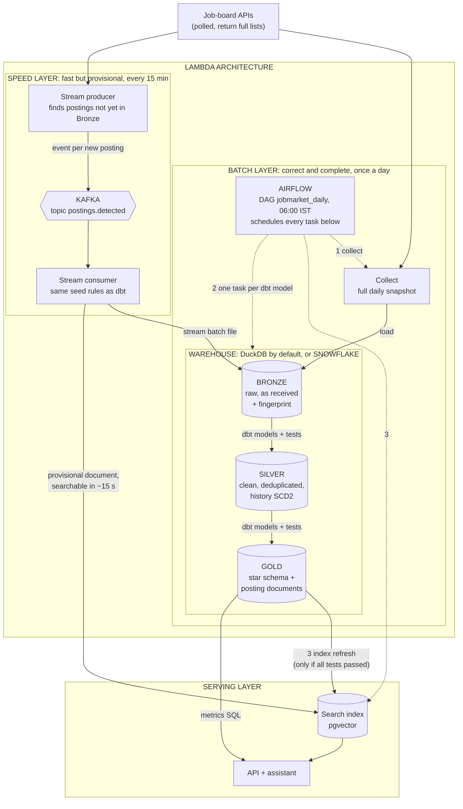
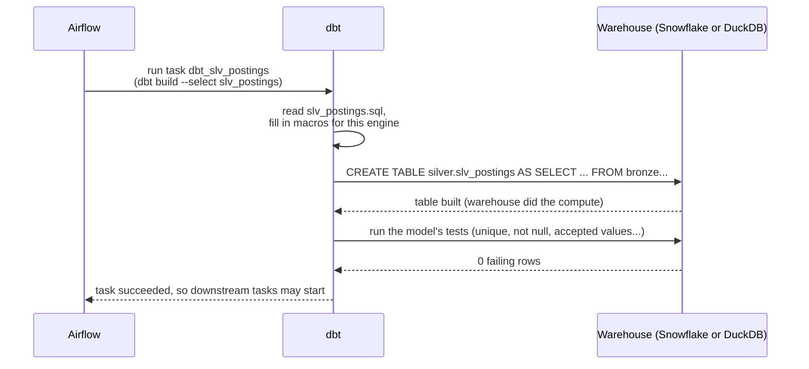
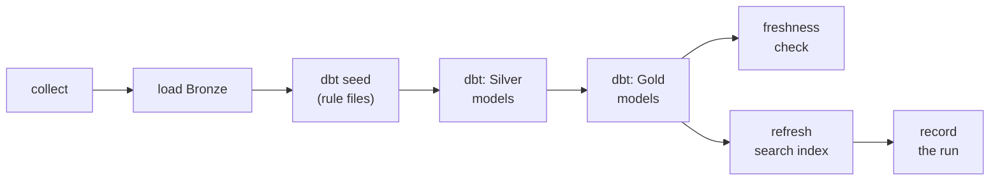
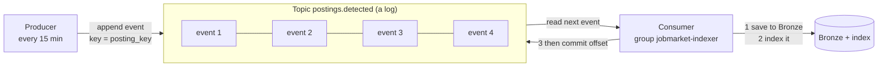
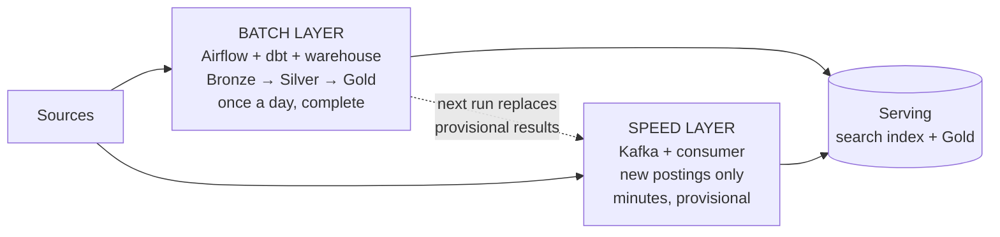
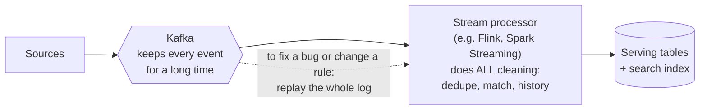
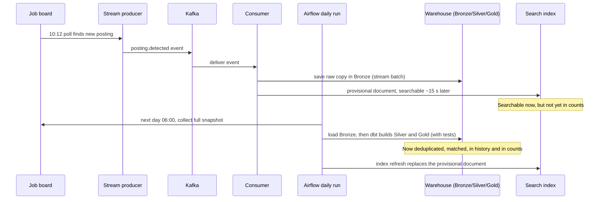

# How the Pieces Operate Together

This page shows how **Snowflake, dbt, Airflow, Kafka, the Bronze, Silver and Gold layers, and the Lambda and Kappa architectures** fit together in this project.

These names are different *kinds* of things, which is the most common source of confusion. Sort them first:

| Name | What kind of thing it is | Its job in one phrase | In this project |
|---|---|---|---|
| **Bronze, Silver, Gold** | Data **layers** (the Medallion pattern) | *What state the data is in*: raw, clean, ready to use | Three schemas, in DuckDB or Snowflake |
| **Snowflake** | A cloud **warehouse** (storage + compute) | *Where* the layers live | Optional cloud target; DuckDB is the daily default |
| **dbt** | A **transformation tool** | *How* data moves from Bronze to Silver to Gold: SQL files plus tests | 17 models, run on either warehouse |
| **Airflow** | An **orchestrator** (scheduler) | *When* each step runs, in what order, with retries | The `jobmarket_daily` DAG, 06:00 IST |
| **Kafka** | An **event log** (message broker) | *How fast* new data travels: events as they happen | The topic `postings.detected` |
| **Lambda** | An **architecture pattern** | A batch layer for correctness **plus** a speed layer for freshness | **Used** |
| **Kappa** | An **architecture pattern** | **Only** a streaming layer; rebuild by replaying the log | Considered, **not used** |

The short version: **Airflow** decides *when*, **dbt** decides *how*, **Snowflake** is *where*, **Bronze/Silver/Gold** is *what state*, **Kafka** is *how fast*, and **Lambda vs Kappa** is *how the batch and fast paths are combined*.

---

## 1. The whole machine

Read from top to bottom. The left half is the **batch layer**, the right half is the **speed layer**. Together they are the **Lambda architecture**.

What to notice:

- **Airflow doesn't touch data itself.** It only starts tasks (dotted arrows): collect, then each dbt model, then the index refresh.
- **dbt doesn't store data.** It sends SQL to the warehouse, and the warehouse (DuckDB or Snowflake) does the work and keeps the tables.
- **Bronze, Silver and Gold all live inside the warehouse.** They are schemas, not separate systems.
- **Kafka is only in the speed layer.** The batch layer never reads it.
- **Both layers feed the same search index.** The batch version always replaces the speed layer's provisional one on the next run.

---

## 2. Snowflake and dbt: who does what

dbt is often mistaken for a database. It isn't: it turns SQL files into tables by sending them to a warehouse, and checks the result with tests.

On **Snowflake**, each step uses its own least-privileged role:

| Step | Tool | Snowflake role | Writes to |
|---|---|---|---|
| Load raw files | Python loader | `JMA_INGEST` | `BRONZE` |
| Build Silver and Gold | dbt | `JMA_TRANSFORM` | `SILVER`, `GOLD` |
| Answer questions | API | `JMA_SERVE` | nothing (reads `GOLD` only) |

The same dbt project builds on **DuckDB** with no changes, because engine-specific SQL is wrapped in macros. That's why the daily run can use free local DuckDB and Snowflake stays optional ([ADR-0005](decisions/0005-portable-warehouse-layer.md)).

---

## 3. Airflow: the daily timetable

Each box is one Airflow task. A task starts only when the tasks before it have succeeded.

In the real DAG, the two dbt boxes are 17 separate tasks, one per model, wired in the same order as dbt's own dependencies ([ADR-0010](decisions/0010-dbt-in-airflow.md)). Each runs its model **and its tests**, so a failing test stops that branch, and the index refresh (which publishes Gold to the assistant) never runs on bad data. Failed tasks retry twice and then raise an alert.

---

## 4. Kafka: the event log

Kafka keeps an ordered log of events. Producers append to it; consumers read from it at their own pace and record how far they've got (their **offset**).

The consumer commits its offset **only after** the posting is saved and indexed. If it crashes halfway, it reads the same event again after restarting, and because processing is idempotent the repeat changes nothing. This is called **at-least-once** delivery. The code is in [streaming.py](https://github.com/vvanurag/job-market-assistant/blob/main/src/jobmarket/streaming.py) and the `stream` commands in [cli.py](https://github.com/vvanurag/job-market-assistant/blob/main/src/jobmarket/cli.py).

---

## 5. Lambda versus Kappa

Both patterns answer the same question: *how do you get data that is both fresh and correct?*

### Lambda (used here): two paths, batch wins

### Kappa (not used): one streaming path, replay to rebuild

| | Lambda | Kappa |
|---|---|---|
| Paths | Two: batch and speed | One: streaming only |
| Source of truth | The batch layer (Gold) | The Kafka log |
| Fixing a bug | Rerun the batch | Replay the log through the fixed processor |
| Cost | Some rules exist twice (SQL and Python) | Every transformation must be written as a stream job |
| Best when | Sources are snapshots; batch SQL already exists | Sources truly emit events; everything must be real-time |

**Why Lambda here** ([ADR-0009](decisions/0009-lambda-architecture-for-streaming.md)):

1. Job boards are **polled**; they return the full list, not change events.
2. A posting closes by **disappearing**. "Something is missing" isn't an event Kafka can carry; it needs two snapshots compared, which is batch work.
3. All cleaning is already tested **dbt SQL** that runs on two warehouses. Kappa would mean rewriting it as stream jobs.

So the batch layer stays the truth, and Kafka adds only what the batch is slow at: new postings, searchable within seconds instead of the next morning.

---

## 6. One posting's journey through both layers

A new job is published at 10:00. The stream finds it within 15 minutes; the batch confirms it the next morning.

---

## Related pages

- [Architecture Decisions, Explained](architecture.md): the reasons behind each choice.
- [Orchestration](operations/orchestration.md), [Streaming](operations/streaming.md), [Running on Snowflake](pipeline/snowflake.md): how to run each part.
- [Bronze](pipeline/bronze.md), [Silver](pipeline/silver.md), [Gold](pipeline/gold.md): what each layer contains.
