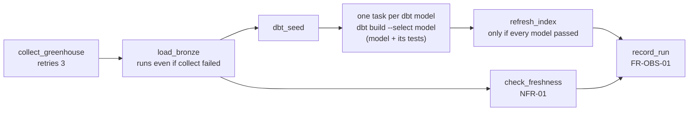

# Orchestration

The daily batch pipeline runs in **Apache Airflow 3** in Docker. It covers ingestion, transformation, tests, the index refresh and the run record.

| | |
|---|---|
| **Requirements** | FR-ORC-01 to FR-ORC-04, FR-OBS-01, NFR-01, NFR-16 |
| **Decision** | [ADR-0010](../decisions/0010-dbt-in-airflow.md) |
| **Code** | `orchestration/dags/jobmarket_daily.py`, `orchestration/Dockerfile`, `src/jobmarket/ops.py` |

---

## The DAG



| Behaviour | How | Requirement |
|---|---|---|
| Runs daily at 06:00 IST (00:30 UTC) | `schedule="30 0 * * *"` | FR-ORC-01 |
| Each model is its own task, with dbt's dependencies | Built from `transform/target/manifest.json` | FR-ORC-02 |
| A failed test stops publishing | A model's tests run in its task; `refresh_index` needs every model task to succeed | FR-ORC-03 |
| Alerts | Any failed task, and stale data, call `jobmarket ops alert`: stored in `public.alerts` and sent to `ALERT_WEBHOOK_URL` if set | FR-ORC-04 |
| Freshness | `check_freshness` fails if the newest Greenhouse load is older than 26 hours | NFR-01 |
| Failure isolation | `load_bronze` runs even when collection fails, so existing data is still published | NFR-16 |
| Run record | `record_run` stores per-source counts, durations, errors, dbt statuses and index statistics in `public.pipeline_runs`, even for failed runs | FR-OBS-01 |
| Retries | 2 retries with exponential backoff (collection: 3) | FR-ING-06 |

## Running it

```bash
make up                                        # vector database
docker compose --profile pipeline up -d        # Airflow at http://localhost:8080
```

The DAG starts **paused**. Turn it on in the Airflow UI (the toggle next to `jobmarket_daily`), or trigger one run from the terminal:

```bash
docker exec jma-airflow airflow dags unpause jobmarket_daily
docker exec jma-airflow airflow dags trigger jobmarket_daily
```

**Your Mac must be on, with Docker running, at 06:00 IST** for the scheduled run to happen. Airflow runs any missed run when it next starts (`catchup=False` means only the latest).

### Phone alerts (optional)

Set `ALERT_WEBHOOK_URL` in `.env` to a private [ntfy.sh](https://ntfy.sh) topic, for example `https://ntfy.sh/jobmarket-<random words>`, and install the ntfy app subscribed to the same topic. Without it, alerts are still recorded and shown in the health view.

## Notes

- The container mounts the repository at `/opt/jobmarket`, so it reads the same `.env`, data folder and code as your terminal. It overrides only what differs inside Docker: the Ollama and database addresses, and the Snowflake key path (`~/.snowflake` is mounted read-only).
- DuckDB allows one writer at a time. While the pipeline's dbt tasks run (a few minutes), the API and other local tools can't open the DuckDB file. Serving from Snowflake (`SERVING_WAREHOUSE=snowflake`) avoids this.
- NFR-01 is measured over 7 consecutive days of scheduled runs, so it can only be confirmed after a week of operation.
