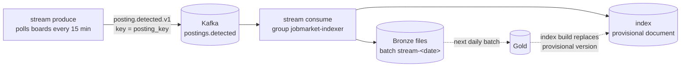

# Streaming

New postings become searchable within minutes through a Kafka speed layer. The daily batch remains the source of truth ([ADR-0009](../decisions/0009-lambda-architecture-for-streaming.md)).

| | |
|---|---|
| **Requirements** | FR-STR-01 to FR-STR-04, NFR-02 |
| **Code** | `src/jobmarket/streaming.py`, the `kafka` service in `docker-compose.yml` (Apache Kafka 4.4, single-node KRaft) |

---



## Running it

```bash
docker compose --profile streaming up -d     # Kafka on localhost:9094
.venv/bin/jobmarket stream produce           # terminal 1: polls every 15 minutes
.venv/bin/jobmarket stream consume           # terminal 2: indexes each new posting
```

## The event

```json
{
  "event_id": "9f1c…",
  "event_type": "posting.detected.v1",
  "detected_at": "2026-11-06T10:00:00+00:00",
  "source_id": "greenhouse",
  "posting_key": "md5(source_id | source_posting_id)",
  "record": { "source_posting_id": "…", "board_token": "…", "company_name": "…", "collected_at": "…", "job": { "…": "as returned by the API" } }
}
```

The key is `posting_key`, so every event about one posting lands in the same partition, in order.

## Guarantees

| Property | How |
|---|---|
| Nothing lost | Offsets are committed only after the event is written to Bronze and indexed (at-least-once) |
| Repeats are harmless | Bronze files are rewritten in place; the index skips a posting it already has |
| Batch wins | A posting the batch already indexed is never overwritten. Provisional documents are always replaced by the next index build |
| One posting, two paths (FR-STR-03) | Both layers use `md5(source_id | source_posting_id)` |

## Measured latency (NFR-02)

Replaying 5 real postings through Kafka on 2026-11-06: about **0.23 s** of processing per event, searchable about **15 s** after detection. The target is 60 minutes. Detection itself happens at the next poll, so a posting's worst case is the poll interval (15 minutes) plus processing. Each event's latency is recorded in `public.stream_events`.
