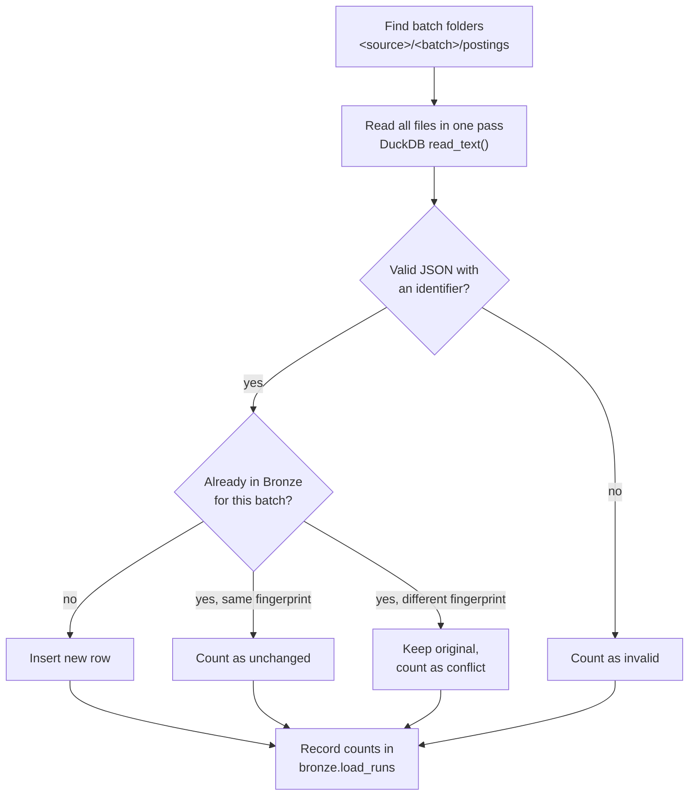

# Bronze Layer

The Bronze layer stores every record **exactly as it was received**, together with information about where and when it arrived. Nothing is cleaned or changed here. That happens in Silver.

Keeping an untouched copy means any later step can be rerun or corrected from the original data, without collecting it again.

| | |
|---|---|
| **Requirements** | FR-ING-03 (raw storage with metadata), FR-ING-04 (idempotent loads), FR-OBS-01 (run records), NFR-16 (failure isolation), NFR-17 (re-run without duplicates) |
| **Code** | `src/jobmarket/bronze/loader.py` |
| **Tests** | `tests/test_bronze_loader.py` |
| **Engine** | DuckDB (local). Snowflake follows the same design ([ADR-0005](../decisions/0005-portable-warehouse-layer.md)) |

---

## Input: raw files

Collectors write one JSON file per posting, grouped by source and batch:

```
data/bronze/
└── <source_id>/          which system the records came from
    └── <batch_id>/       one collection run, e.g. a date
        └── postings/
            ├── 4481247187.json
            └── ...
```

The loader finds every `postings` folder automatically. Each file must contain one JSON object with an identifier in one of these fields, checked in order: `source_posting_id`, `job_id`, `id`.

## Output: tables

### `bronze.raw_postings`

One row per posting per batch.

| Column | Type | Meaning |
|---|---|---|
| `source_id` | varchar | Source system, from the folder name |
| `batch_id` | varchar | Collection run, from the folder name |
| `source_posting_id` | varchar | The source's own identifier for the posting |
| `record_hash` | varchar | SHA-256 of the raw file content: a fingerprint used to detect changes |
| `payload` | json | The record exactly as received |
| `file_name` | varchar | File path relative to `data/bronze/` |
| `loaded_at` | timestamptz | When the load started |
| `load_run_id` | varchar | Links to `bronze.load_runs` |

**Grain:** one row per (`source_id`, `batch_id`, `source_posting_id`). This is the primary key.

### `bronze.load_runs`

One row per load of a batch, for auditing and monitoring.

| Column | Meaning |
|---|---|
| `files_seen` | Files found in the batch folder |
| `rows_inserted` | New rows written |
| `rows_unchanged` | Already loaded, with identical content |
| `rows_conflicting` | Already loaded, but the file now has different content |
| `rows_invalid` | Not valid JSON, or no identifier |
| `status` | `succeeded`, `succeeded_with_warnings`, `empty` or `failed` |
| `error` | Error message when `status` is `failed` |

## How a load works



Each batch loads inside one transaction: it either loads completely or not at all. Batches are independent, so one failing batch doesn't stop the others.

### Design choices

| Choice | Reason |
|---|---|
| Load the whole file as `json`, not parsed columns | Bronze must not lose or reinterpret anything. Parsing into typed columns is Silver's job (FR-TRN-01) |
| Never overwrite an existing row | Bronze is a permanent record of what was received. If a source re-delivers different content, the conflict is reported for investigation |
| Fingerprint every record | Makes "has this changed?" a cheap comparison, and later drives re-embedding only changed postings (FR-IDX-04) |
| Read files with SQL (`read_text`) | One pass over all files, fast (2,000 files in under a second), and the same approach works in Snowflake with `COPY INTO` |

## Running it

```bash
make bronze                      # load every batch, then show the totals

.venv/bin/jobmarket bronze load                            # load every batch
.venv/bin/jobmarket bronze load --source my_source         # one source
.venv/bin/jobmarket bronze load --source my_source --batch 2026-11-05
.venv/bin/jobmarket bronze status                          # rows per source and batch
```

Example output when a batch is loaded twice:

```
source               batch         files    new   same  changed  invalid  status
my_source            2026-11-05     2000   2000      0        0        0  succeeded

source               batch         files    new   same  changed  invalid  status
my_source            2026-11-05     2000      0   2000        0        0  succeeded
```

## Querying Bronze

The JSON payload can be queried directly. For example, postings per batch with a mention of Databricks:

```sql
select batch_id,
       count(*) as postings,
       count(*) filter (where payload->>'$.raw_description' ilike '%databricks%') as mention_databricks
from bronze.raw_postings
group by batch_id;
```

Bronze queries are for exploration only. Reports and the assistant use the cleaned Silver and Gold layers.
