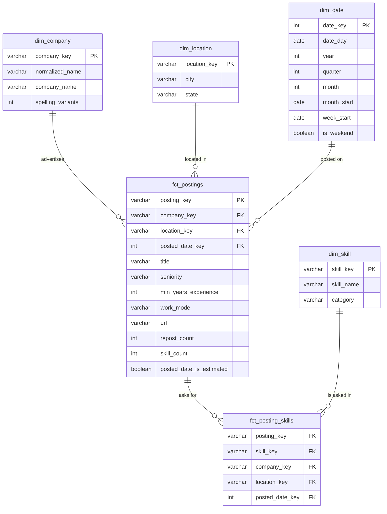

# Gold Layer

The Gold layer is the **business-ready** view of the job market: a star schema of facts and dimensions that answers questions with short, simple SQL. Reports, and later the assistant's analytical answers, read from Gold only.

| | |
|---|---|
| **Requirements** | FR-TRN-04 (company normalisation), FR-TRN-10 (Gold tables), FR-TRN-11 (grain and tests), NFR-12 (serving role reads Gold only) |
| **Models** | `transform/models/gold/` |
| **Design method** | Kimball dimensional modeling. See the [SQL & Data Modeling guide](https://vvanurag.github.io/ELT_pipeline/tutorials/sql_and_data_modeling/), Lesson 7 |

---

## Design

| Kimball step | Decision |
|---|---|
| **1. Business process** | A company advertising a data or AI role |
| **2. Grain** | `fct_postings`: one row per **unique** job, so reposts are counted once. `fct_posting_skills`: one row per job per skill |
| **3. Dimensions** | Company, skill, city, date |
| **4. Facts** | Repost count, skill count, whether the posted date is estimated |



`fct_posting_skills` copies the job's company, city and date keys onto every row. That breaks strict normalisation on purpose: the most common questions ("top skills in Bengaluru this month") then need one join instead of three.

## Tables

| Table | Grain | Built from | Notes |
|---|---|---|---|
| `fct_postings` | One unique data/AI job | `slv_postings` where `is_canonical` and `is_target_role`, plus `slv_posting_attributes` | `seniority` and `work_mode` are inferred, with `*_basis` columns saying how. `posted_date` falls back to the first-loaded date when a source gives none, flagged by `posted_date_is_estimated` |
| `fct_posting_skills` | One (job, skill) pair | `fct_postings` × `slv_posting_skills` | Factless fact table: the row itself is the fact |
| `dim_company` | One company | `slv_postings` | Names normalised so spellings like "Mercari India" and "Mercari" merge. `company_name` shows the most common original spelling |
| `dim_skill` | One skill | `skills` seed | |
| `dim_location` | One target city | `city_aliases` seed | |
| `dim_date` | One calendar day | Generated by the `date_spine` macro | Range set by `date_spine_start` / `date_spine_end` in `dbt_project.yml` |

### Company name normalisation

`normalize_company()` builds a matching key: lowercase, punctuation to spaces, drop a trailing "India" or "in India", drop legal suffixes such as Inc, Ltd, Pvt, LLC and Corp, and collapse spaces. So "Accenture in India", "ACCENTURE" and "Accenture Pvt. Ltd." become one company, `accenture`.

## Example questions

Results from 2026-11-05 data: 1,877 unique jobs, 805 companies, 26,343 job–skill pairs.

**Which companies hire the most data/AI roles?**

```sql
select c.company_name,
       count(*) filter (where f.location_key = 'bengaluru') as bengaluru,
       count(*) filter (where f.location_key = 'hyderabad') as hyderabad,
       count(*) as total
from gold.fct_postings f
join gold.dim_company c using (company_key)
group by 1
order by total desc
limit 5;
```

| company_name | bengaluru | hyderabad | total |
|---|---|---|---|
| Infosys | 42 | 9 | 51 |
| Accenture in India | 22 | 21 | 43 |
| Deloitte | 6 | 23 | 29 |
| Tata Consultancy Services | 20 | 8 | 28 |
| Amgen | 0 | 24 | 24 |

**What share of jobs asks for each kind of skill?**

```sql
select s.category,
       count(distinct ps.posting_key) as jobs,
       round(100.0 * count(distinct ps.posting_key) / (select count(*) from gold.fct_postings)) as pct_of_jobs
from gold.fct_posting_skills ps
join gold.dim_skill s using (skill_key)
group by 1
order by jobs desc;
```

| category | jobs | pct_of_jobs |
|---|---|---|
| Programming language | 1,687 | 90 |
| Cloud | 1,401 | 75 |
| MLOps and DevOps | 1,204 | 64 |
| Data practice | 1,166 | 62 |
| Warehouse and lakehouse | 1,123 | 60 |
| Data processing | 990 | 53 |
| Generative AI | 978 | 52 |

**How common are GenAI skills in each city?** (percentage of that city's jobs)

| skill | Bengaluru | Hyderabad |
|---|---|---|
| LLMs | 36.5% | 37.9% |
| AI agents | 31.8% | 34.3% |
| Generative AI | 29.0% | 34.8% |
| RAG | 25.6% | 31.8% |
| LangChain | 15.6% | 20.2% |

## Known limitations

| Limitation | Effect | Resolution |
|---|---|---|
| Most postings come from one collection run | Weekly counts lean towards recent weeks, because the run collected mostly recent postings. They aren't yet a trend | Daily collection over several weeks (Phase 3) |
| Seniority and work mode are inferred | Seniority is `unknown` for 7% of jobs, and work mode for 85%; inferred levels can be one step off (see [Silver](silver.md#checking-accuracy)) | Filter or group on the `*_basis` columns when precision matters |
| Same job across sources not yet matched | A job on both Greenhouse and the backfill counts twice | Cross-source matching (FR-TRN-03) |
| Display name is the most common spelling | Some names keep suffixes such as "in India" | Optional display-name overrides |
