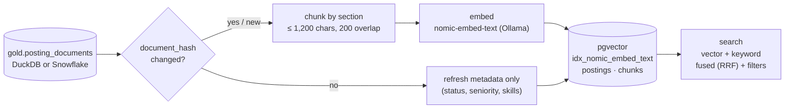

# Retrieval Index

The retrieval index makes job descriptions searchable **by meaning**. Each description is split into chunks, each chunk is turned into an embedding (a list of 768 numbers that captures its meaning), and the chunks are stored in PostgreSQL with pgvector, together with the job's metadata.

| | |
|---|---|
| **Requirements** | FR-IDX-01 to FR-IDX-07, NFR-04 |
| **Decisions** | [ADR-0004](../decisions/0004-vector-store-selection.md) (pgvector), [ADR-0007](../decisions/0007-chunking-strategy.md) (chunking) |
| **Code** | `src/jobmarket/index/` (`chunking.py`, `store.py`, `build.py`), `src/jobmarket/llm.py` (embeddings) |
| **Input** | `gold.posting_documents`: one row per job, description and metadata |

---

## How it works



| Step | What happens | Requirement |
|---|---|---|
| Read | The builder reads `gold.posting_documents` from the serving warehouse: DuckDB locally, or Snowflake as the read-only `JMA_SERVE` role | NFR-12 |
| Compare | Each job's `document_hash` (title, company, city, description) and the chunker version are compared with what the index holds | FR-IDX-04 |
| Unchanged | Only the metadata is updated, with no re-embedding. A job that closed gets `status = 'closed'` and drops out of default searches in the same run | FR-IDX-04, FR-IDX-05 |
| New or changed | Re-chunked and re-embedded; its old chunks are replaced in the same transaction | FR-IDX-01 |
| Gone from Gold | Deleted, and its chunks go with it (foreign-key cascade) | FR-IDX-05 |
| Record | Each build writes a row to `public.index_builds`: embedding model, dimensions, chunker version, counts | FR-IDX-07 |

Re-running a build with nothing changed embeds nothing: 1,872 jobs refreshed in under a second.

## What each chunk carries

| Metadata | Used for |
|---|---|
| `posting_key`, title, company, URL | Citations (FR-QA-03) |
| City (Hyderabad, Bengaluru, Remote (India)), work mode, seniority, minimum years | Filters (US-03, US-06) |
| Skills (from the skill dictionary) | "must mention dbt and Snowflake" filters |
| Status (open or closed), posted date, last seen | "open roles posted this week" |
| Section name | Explains where in the posting the text came from |

## Search

`store.search()` runs two rankings over the chunks that pass the filters, then fuses them:

- **Vector:** cosine distance between the query embedding and each chunk, using an HNSW index.
- **Keyword:** PostgreSQL full-text search (`websearch_to_tsquery`, ranked with `ts_rank_cd`). This catches exact terms that embeddings blur, such as "PySpark" and "SCD2".
- **Fusion:** Reciprocal Rank Fusion, `score = 1/(60 + vector rank) + 1/(60 + keyword rank)`, at most 2 chunks per job.

Filters (city, work mode, seniority, skills, company, posted since, open only) apply **inside** both rankings, so a filter never empties the result after the fact.

```bash
make up                                     # start PostgreSQL + pgvector
make index                                  # build or refresh the index
.venv/bin/jobmarket index search "what does strong Kafka experience mean"
.venv/bin/jobmarket index search "dbt and snowflake" --city Hyderabad --work-mode hybrid
.venv/bin/jobmarket index search "SCD2 snapshots" --mode keyword
```

## Results (2026-11-06)

| Measure | Value |
|---|---|
| Jobs indexed | 1,872 |
| Chunks | 12,444 (about 6.6 per job) |
| Full build, local `nomic-embed-text` | 107 s |
| Rebuild with nothing changed | under 1 s, 0 embeddings |
| Search latency (hybrid, filtered), p50 / p95 | 3.9 / 8.8 ms, plus about 30 ms to embed the query; NFR-04 target is p95 < 1.5 s |

Example (`"dbt and snowflake analytics engineering"`, Hyderabad, hybrid): the top results are the Snowflake-and-dbt data engineering roles at Blumetra Solutions. Their "Key Responsibilities" chunks mention dbt models, tests, snapshots and macros.

## Limitations

- Backfill postings can't be re-checked, so they stay `open` as of their only collection run (see [Silver](silver.md#slv_posting_history-table)).
- Search quality is measured in Phase 7 with the evaluation set. The numbers above are speed, not quality.
