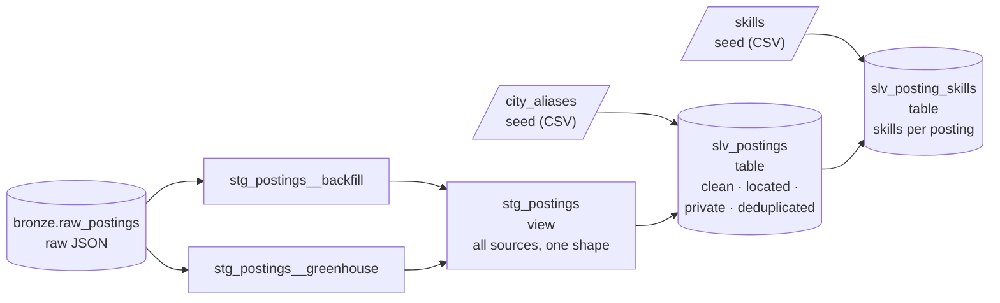

# Silver Layer

The Silver layer turns raw Bronze records into **clean, trustworthy rows**: typed columns, a known city, no personal contact details, and reposts identified. It's built with **dbt**, as SQL models in `transform/`.

| | |
|---|---|
| **Requirements** | FR-ING-01 (two sources), FR-TRN-01 (typed columns), FR-TRN-05 (skills), FR-TRN-02 (latest version), FR-TRN-11 (grain and tests), FR-TRN-12 (target cities), NFR-15 (personal data removed), NFR-24 (portable SQL) |
| **Models** | `transform/models/staging/`, `transform/models/silver/slv_postings.sql`, `transform/models/silver/slv_posting_skills.sql` |
| **Engine** | DuckDB locally; Snowflake through the same models ([ADR-0005](../decisions/0005-portable-warehouse-layer.md)) |

---

## Models



### Staging views

Each source stores a different raw format, so each has its own staging model that maps it to one common set of columns. `stg_postings` combines them.

| Model | Source format | Notes |
|---|---|---|
| `stg_postings__backfill` | Flat JSON records from the initial backfill batch | "Not Applicable" seniority becomes NULL |
| `stg_postings__greenhouse` | Greenhouse API job objects | HTML descriptions converted to plain text by the `html_to_text` macro; `first_published` is the posted date |
| `stg_postings` | All of the above, combined | To add a source, add a model with the same columns and list it here |

Nothing is removed or interpreted in staging, apart from trimming text and casting types.

**Grain:** one row per Bronze record (`source_id`, `batch_id`, `source_posting_id`).

### `slv_postings` (table)

**Grain:** one row per posting per source (`source_id`, `source_posting_id`). Key: `posting_key`.

| Step | What it does | Why |
|---|---|---|
| 1. Latest version | If a posting arrived in several batches, keep the most recent | One current row per posting (FR-TRN-02) |
| 2. City | Match the location text against `city_aliases`, preferring a city name over an area name over a state | Every row belongs to Hyderabad or Bengaluru; others are excluded (FR-TRN-12) |
| 3. Privacy | Replace email addresses and Indian mobile numbers with `[email removed]` / `[phone removed]` | Personal data never reaches Gold or the search index (NFR-15) |
| 4. Fingerprint | md5 of company name plus the description with whitespace normalised | The same text at the same company is a repost |
| 5. Canonical | In each repost group, the earliest-posted row becomes canonical | Gold counts each real job once |
| 6. Target role | Flag titles that are data engineering, analytics, ML or AI roles (`is_target_role`) | Some sources return every role at a company; Gold and the assistant use only target roles |

Reposts are **flagged, not deleted** (`is_canonical`, `canonical_posting_key`, `copies_in_group`), so the duplicate rate can be measured and the data-quality experiment can compare indexes built with and without deduplication.

### `slv_posting_skills` (table)

**Grain:** one row per (`posting_key`, `skill_id`). It lists every skill from the skill dictionary that a posting mentions in its title or description.

Matching is whole-word: the characters on either side of a match must not be letters or digits. So `sql` matches "SQL," and "SQL/NoSQL" but not "MySQL", and `java` doesn't match "JavaScript".

## Skill dictionary

`transform/seeds/skills.csv` holds about 130 skills, each with a name, a category and a pattern:

| skill_id | skill_name | category | pattern |
|---|---|---|---|
| `spark` | Apache Spark | Data processing | `spark\|pyspark\|apache spark\|spark sql` |
| `glue` | AWS Glue | Data integration | `aws glue` |
| `golang` | Go | Programming language | `golang` |

Ambiguous words get stricter patterns: "AWS Glue" rather than "glue", and "Go" only as "golang", because "go" is a common English word.

**To add a skill:** add a row, run `make dbt-build`, then spot-check a few matches (below). Patterns are lowercase regular expressions without backslashes: write `[.]` for a literal dot and `[+]` for a plus.

### Checking accuracy

A pattern can be wrong in two ways: it can match the wrong thing (a false positive) or miss real mentions. Each new or changed pattern is checked by reading the text around a sample of its matches.

On 2026-11-05, 12 of the riskiest patterns were checked this way. 11 were correct, including Git, Amazon S3, RAG, Hive, Oracle, Shell scripting and CI/CD. **Excel** was wrong: almost every match was the verb ("the opportunity to excel"). Its pattern was narrowed to "MS Excel", "Microsoft Excel", "advanced Excel", "Excel skills" and similar, which cut its matches from 194 to 25, all genuine.

A measured precision figure, from a labelled sample of postings, is part of the Evaluation phase.

## City aliases

`transform/seeds/city_aliases.csv` lists the text that identifies each city:

| `match_level` | Examples | Used when |
|---|---|---|
| `city` | hyderabad, secunderabad, bengaluru, bangalore | The city is named |
| `area` | kondapur, gachibowli, whitefield, anekal | Only a neighbourhood or nearby town is named |
| `state` | telangana, karnataka | Only the state is given |

To support a new spelling, add a row and rebuild.

## Portable SQL

Engine-specific functions are wrapped in macros in `transform/macros/portability.sql`, each with a DuckDB and a Snowflake version:

| Macro | DuckDB | Snowflake |
|---|---|---|
| `json_str(col, path)` | `json_extract_string(col, '$.path')` | `col:path::varchar` |
| `replace_all(expr, pattern, repl)` | `regexp_replace(..., 'g')` | `regexp_replace(...)` |
| `matches(expr, pattern)` | `regexp_matches(...)` | `regexp_instr(...) > 0` |

Regex patterns avoid backslashes (`[.]` instead of `\.`), because the two engines treat backslashes in string literals differently.

## Tests

`make dbt-build` builds every model and runs its tests:

| Test | Checks |
|---|---|
| `unique`, `not_null` on keys | Grain holds |
| `accepted_values` on `city` and `city_match_level` | Only expected values |
| `relationships` on `canonical_posting_key` | Every repost points at a real posting |
| `assert_no_pii_in_silver_descriptions` | No email or phone number remains |
| `assert_one_canonical_per_repost_group` | Each repost group has exactly one canonical row |
| `unique` on `slv_posting_skills` (posting, skill) | A skill is listed once per posting |
| `relationships` on `slv_posting_skills` | Every row points at a real posting and a real skill |

## Running it

```bash
make bronze        # load raw files first
make dbt-build     # build and test staging and Silver on DuckDB
```

Results on 2026-11-05, two sources:

| | Backfill | Greenhouse |
|---|---|---|
| Postings in Silver | 2,000 | 628 |
| Unique after reposts removed | 1,816 | 614 |
| Target data/AI roles | 1,998 | 65 |

Skills: 1,868 of the 1,877 unique target-role postings mention at least one dictionary skill, with 14 on average. The most common are Python, SQL, AWS, Azure and CI/CD.

Known gap: Silver resolves the city from a job's main location only. Greenhouse jobs whose main location is, say, "Remote", but which list a Hyderabad or Bengaluru office, are collected but not yet included.
