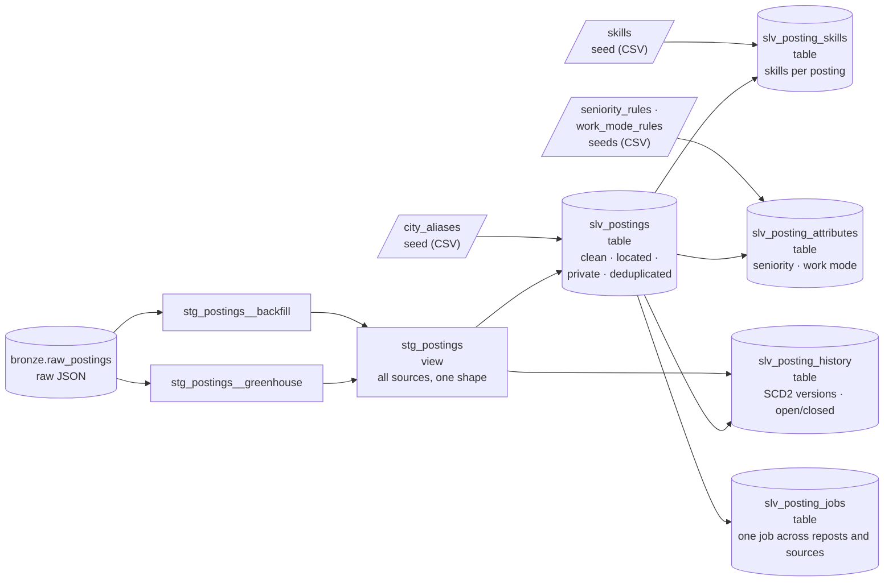

# Silver Layer

The Silver layer turns raw Bronze records into **clean, trustworthy rows**: typed columns, a known city, no personal contact details, and reposts identified. It's built with **dbt**, as SQL models in `transform/`.

| | |
|---|---|
| **Requirements** | FR-ING-01 (two sources), FR-TRN-01 (typed columns), FR-TRN-05 (skills), FR-TRN-03 (cross-source matching), FR-TRN-06 (seniority and work mode), FR-TRN-08/09 (history and closed postings), FR-TRN-02 (latest version), FR-TRN-11 (grain and tests), FR-TRN-12 (target cities), NFR-15 (personal data removed), NFR-24 (portable SQL) |
| **Models** | `transform/models/staging/`, `transform/models/silver/slv_postings.sql`, `transform/models/silver/slv_posting_skills.sql`, `transform/models/silver/slv_posting_attributes.sql`, `slv_posting_history.sql`, `slv_posting_jobs.sql` |
| **Engine** | DuckDB locally; Snowflake through the same models ([ADR-0005](../decisions/0005-portable-warehouse-layer.md)) |

---

## Models



### Staging views

Each source stores a different raw format, so each has its own staging model that maps it to one common set of columns. `stg_postings` combines them.

| Model | Source format | Notes |
|---|---|---|
| `stg_postings__backfill` | Flat JSON records from the initial backfill batch | "Not Applicable" seniority becomes NULL |
| `stg_postings__greenhouse` | Greenhouse API job objects | HTML descriptions converted to plain text by the `html_to_text` macro; `first_published` is the posted date |
| `stg_postings` | All of the above, combined | To add a source, add a model with the same columns and list it here |

Nothing is removed or interpreted in staging, apart from trimming text and casting types.

**Grain:** one row per Bronze record (`source_id`, `batch_id`, `source_posting_id`).

### `slv_postings` (table)

**Grain:** one row per posting per source (`source_id`, `source_posting_id`). Key: `posting_key`.

| Step | What it does | Why |
|---|---|---|
| 1. Latest version | If a posting arrived in several batches, keep the most recent | One current row per posting (FR-TRN-02) |
| 2. City | Match the location text against `city_aliases` as whole words, preferring a city name, then an area, then a state, then a remote role open to India | Every row belongs to Hyderabad, Bengaluru or Remote (India); others are excluded (FR-TRN-12, Q6). Whole words, so "Remote - India" matches but "Remote - Indiana, USA" doesn't |
| 3. Privacy | Replace email addresses and Indian mobile numbers with `[email removed]` / `[phone removed]` | Personal data never reaches Gold or the search index (NFR-15) |
| 4. Fingerprint | md5 of company name plus the description with whitespace normalised | The same text at the same company is a repost |
| 5. Canonical | In each repost group, the earliest-posted row becomes canonical | Gold counts each real job once |
| 6. Target role | Flag titles that are data engineering, analytics, ML or AI roles (`is_target_role`) | Some sources return every role at a company; Gold and the assistant use only target roles |

Reposts are **flagged, not deleted** (`is_canonical`, `canonical_posting_key`, `copies_in_group`), so the duplicate rate can be measured and the data-quality experiment can compare indexes built with and without deduplication.

### `slv_posting_skills` (table)

**Grain:** one row per (`posting_key`, `skill_id`). It lists every skill from the skill dictionary that a posting mentions in its title or description.

Matching is whole-word: the characters on either side of a match must not be letters or digits. So `sql` matches "SQL," and "SQL/NoSQL" but not "MySQL", and `java` doesn't match "JavaScript".

### `slv_posting_attributes` (table)

**Grain:** one row per `posting_key`. It holds each posting's **seniority** and **work mode** (FR-TRN-06), and records the evidence that decided each one, so any value can be explained.

Most sources don't give a usable level: 66% of jobs had no seniority value, and most of the rest said only "Mid-Senior", which spans several levels. So seniority is inferred from evidence, strongest first:

| Order | Evidence | Examples | Rules |
|---|---|---|---|
| 1 | Job title | "Senior …", "Lead II", "Engineer II", "Associate Director", "Intern" | `seeds/seniority_rules.csv`, field `title` |
| 2 | The source's own level, only where it names one level | "Entry level", "Director" | `seeds/seniority_rules.csv`, field `source` |
| 3 | Minimum years of experience in the description | "5+ years of experience", "Experience: 3–8 years" | Banded: 0–1 junior, 2–4 mid, 5–7 senior, 8–20 lead |
| 4 | None of the above | | `unknown` |

Title rules are ordered so the more specific word wins: "Associate Director" is a manager, not a junior, and "Lead II" is a lead, not a mid-level role. Years above 20 are ignored, because they nearly always describe the company ("75 years of experience serving clients").

Work mode follows the same pattern: an explicit title or location ("Remote - Bengaluru"), then labelled phrases ("Work mode: Hybrid", "Location: Hyderabad (Hybrid)"), then other phrases ("3 days a week in the office", "fully remote"). Phrases are deliberately specific, so "hybrid cloud", "hybrid search" and "remote teams" don't count.

**Result on 2026-11-05** (1,877 unique jobs):

| Seniority | Bengaluru | Hyderabad | Total |
|---|---|---|---|
| junior | 59 | 46 | 105 |
| mid | 184 | 119 | 303 |
| senior | 447 | 317 | 764 |
| lead | 274 | 227 | 501 |
| manager | 41 | 30 | 71 |
| unknown | 73 | 60 | 133 |

| Work mode | Bengaluru | Hyderabad | Total |
|---|---|---|---|
| hybrid | 141 | 86 | 227 |
| remote | 21 | 12 | 33 |
| on-site | 18 | 8 | 26 |
| unknown | 898 | 693 | 1,591 |

Seniority is known for **93%** of jobs: 62% decided by the title, 3.5% by the source and 27% by years of experience. Work mode is known for only 15%. Most descriptions don't state it, and the rules prefer `unknown` to a guess.

#### Checking accuracy

Where a job has both a title level and a years-of-experience figure, the two can be compared (916 jobs). They fall in the same band **58%** of the time and within one band **96%** of the time. The disagreements are mostly one step up or down: in this market a "Senior" title often asks for 3–4 years, and many "Lead" roles ask for 5–7. That's why the title outranks the years.

Median years asked for, by inferred level: junior 3, mid 3, senior 5, lead 8, manager 9.5. Junior roles asking for 3 years reflect titles such as "Associate", which in Indian IT usually means 2–4 years of experience.

A dbt **unit test** (`models/silver/_silver_unit_tests.yml`) pins the rules down with known examples, such as "Associate Director", "Lead II", "8-12 yrs", "75 years of experience" and "hybrid cloud". It runs with every `make dbt-build`.

### `slv_posting_history` (table)

**Grain:** one row per (`posting_key`, `version_number`). This is a **slowly changing dimension Type 2** (FR-TRN-08): each row is one version of a posting, valid from `valid_from` until `valid_to`, and the current version has `is_current = true`.

It is built from every Bronze delivery, not from dbt snapshots. Rebuilding it from scratch therefore gives the same history, and it comes out the same on DuckDB and Snowflake.

| Step | What it does |
|---|---|
| 1. Runs | Number each source's collection runs (batches) in order |
| 2. Grid | Pair every posting with every run of its source since it was first seen |
| 3. Status | Missing for `closed_after_missed_runs` consecutive runs (default 2, in `dbt_project.yml`) means **closed** (FR-TRN-09). A posting that comes back is **open** again |
| 4. Versions | A new version starts when status, title, location or description changes |

Closing after two missed runs rather than one avoids closing a posting because of a single failed or partial run.

The one-off backfill has a single run, so its postings stay `open` as of that run: their status can't be re-checked. `dim_source.collection` says which sources are re-checked (`daily`) and which aren't (`one-off`).

A unit test (`history_tracks_changes_closure_and_reopening`) walks one posting through a title change, two missed runs (closed) and its return (reopened).

### `slv_posting_jobs` (table)

**Grain:** one row per `posting_key`. It links every posting to one **job** (FR-TRN-03), so a role is counted once, however many times and wherever it was posted.

1. **Reposts.** Postings with the same company and description text are already grouped in `slv_postings`.
2. **Cross-source copies.** Two postings from different sources are the same job when all of these are equal: the company (normalised name), the city, the title (ignoring case and punctuation), and the **first and last 1,000 letters** of the description, ignoring everything that isn't a letter. Comparing letters only removes formatting differences between sources: HTML, bullets and line breaks. Matches are one-to-one.
3. **Representative.** Each job is shown by one posting. A recurring source is preferred, because its open/closed status is re-checked every run.

The title is part of the rule on purpose. Some employers reuse one description for several levels: Databricks posts "Senior" and "Staff" roles with identical text, and those are two jobs.

**Measured precision** (2026-11-06): the rule linked **10** pairs, and all 10 were checked by hand and are the same job (**precision 10/10**). Among the pairs with the same company and city, and the same or a nearly identical title, one real match was missed: the company is "InMobi" on one source and "InMobi Advertising" on the other (**recall 10/11** on the reviewed candidates). Aliases for company names would close that gap.

## Skill dictionary

`transform/seeds/skills.csv` holds about 130 skills, each with a name, a category and a pattern:

| skill_id | skill_name | category | pattern |
|---|---|---|---|
| `spark` | Apache Spark | Data processing | `spark\|pyspark\|apache spark\|spark sql` |
| `glue` | AWS Glue | Data integration | `aws glue` |
| `golang` | Go | Programming language | `golang` |

Ambiguous words get stricter patterns: "AWS Glue" rather than "glue", and "Go" only as "golang", because "go" is a common English word.

**To add a skill:** add a row, run `make dbt-build`, then spot-check a few matches (below). Patterns are lowercase regular expressions without backslashes: write `[.]` for a literal dot and `[+]` for a plus.

### Checking accuracy

A pattern can be wrong in two ways: it can match the wrong thing (a false positive) or miss real mentions. Each new or changed pattern is checked by reading the text around a sample of its matches.

On 2026-11-05, 12 of the riskiest patterns were checked this way. 11 were correct, including Git, Amazon S3, RAG, Hive, Oracle, Shell scripting and CI/CD. **Excel** was wrong: almost every match was the verb ("the opportunity to excel"). Its pattern was narrowed to "MS Excel", "Microsoft Excel", "advanced Excel", "Excel skills" and similar, which cut its matches from 194 to 25, all genuine.

A measured precision figure, from a labelled sample of postings, is part of the Evaluation phase.

## City aliases

`transform/seeds/city_aliases.csv` lists the text that identifies each city:

| `match_level` | Examples | Used when |
|---|---|---|
| `city` | hyderabad, secunderabad, bengaluru, bangalore | The city is named |
| `area` | kondapur, gachibowli, whitefield, anekal | Only a neighbourhood or nearby town is named |
| `state` | telangana, karnataka | Only the state is given |

To support a new spelling, add a row and rebuild.

## Portable SQL

Engine-specific functions are wrapped in macros in `transform/macros/portability.sql`, each with a DuckDB and a Snowflake version:

| Macro | DuckDB | Snowflake |
|---|---|---|
| `json_str(col, path)` | `json_extract_string(col, '$.path')` | `col:path::varchar` |
| `replace_all(expr, pattern, repl)` | `regexp_replace(..., 'g')` | `regexp_replace(...)` |
| `matches(expr, pattern)` | `regexp_matches(...)` | `regexp_instr(...) > 0` |
| `extract_match(expr, pattern)` | `nullif(regexp_extract(..., 0), '')` | `regexp_substr(...)` |

Regex patterns avoid backslashes (`[.]` instead of `\.`), because the two engines treat backslashes in string literals differently.

## Tests

`make dbt-build` builds every model and runs its tests:

| Test | Checks |
|---|---|
| `unique`, `not_null` on keys | Grain holds |
| `accepted_values` on `city` and `city_match_level` | Only expected values |
| `relationships` on `canonical_posting_key` | Every repost points at a real posting |
| `assert_no_pii_in_silver_descriptions` | No email or phone number remains |
| `assert_one_canonical_per_repost_group` | Each repost group has exactly one canonical row |
| `unique` on `slv_posting_skills` (posting, skill) | A skill is listed once per posting |
| `relationships` on `slv_posting_skills` | Every row points at a real posting and a real skill |
| `accepted_values` on seniority, work mode and their rule seeds | Only the documented levels and modes |
| `assert_one_representative_per_job` | Every job has exactly one representative posting |
| Unit test `history_tracks_changes_closure_and_reopening` | Versions, closing after missed runs, and reopening |
| Unit test `seniority_and_work_mode_from_known_examples` | The rules give the expected answer for known titles and phrases |

## Running it

```bash
make bronze        # load raw files first
make dbt-build     # build and test staging and Silver on DuckDB
```

Results on 2026-11-05, two sources:

| | Backfill | Greenhouse |
|---|---|---|
| Postings in Silver | 2,000 | 628 |
| Unique after reposts removed | 1,816 | 614 |
| Target data/AI roles | 1,998 | 65 |

Skills: 1,868 of the 1,877 unique target-role postings mention at least one dictionary skill, with 14 on average. The most common are Python, SQL, AWS, Azure and CI/CD.

Known gap: Silver resolves the city from a job's main location only. Greenhouse jobs whose main location is, say, "Remote", but which list a Hyderabad or Bengaluru office, are collected but not yet included.
