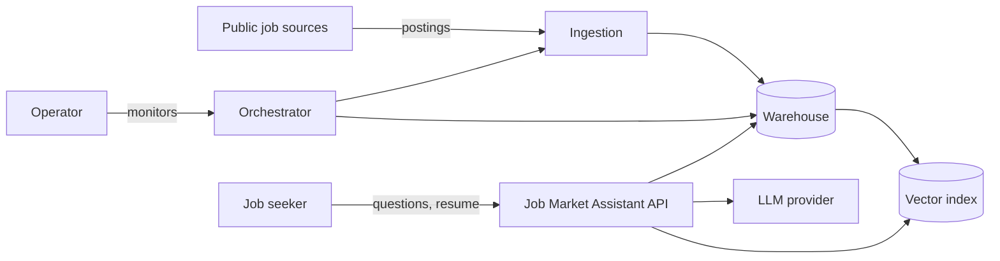

# Functional Requirements

| | |
|---|---|
| **Version** | 0.2 (draft): added FR-TRN-12, FR-QA-08, FR-QA-09; Hyderabad and Bengaluru scope |
| **Status** | In review |
| **Owner** | Anurag V V |
| **Last updated** | 2026-11-05 |

This document lists what the system must do, grouped by component. Each requirement has an ID, a MoSCoW priority, the user stories it supports from the [Product Requirements](product_requirements.md), and the [roadmap](../roadmap.md) phase that delivers it.

**Requirement wording:** "must" is mandatory for version 1; "should" is expected unless there is a documented reason not to; "may" is optional.

---

## 1. Context

## 2. Core data entities

| Entity | Description | Key |
|---|---|---|
| **Source** | A system postings are collected from | `source_id` |
| **Raw posting** | A posting exactly as received, with load metadata | (`source_id`, `source_posting_id`, `loaded_at`) |
| **Posting** | A deduplicated job posting across all sources | `posting_id` |
| **Posting version** | A posting's tracked attributes over a validity period | (`posting_id`, `valid_from`) |
| **Company** | The hiring organisation, normalised across sources | `company_id` |
| **Skill** | A canonical skill, such as "Apache Kafka", with aliases such as "Kafka" | `skill_id` |
| **Posting skill** | A skill mentioned in a posting, with how it was extracted | (`posting_id`, `skill_id`) |
| **Chunk** | A section of posting text with its embedding and metadata | `chunk_id` |

---

## 3. Ingestion (FR-ING)

| ID | Requirement | Priority | Stories | Phase |
|---|---|---|---|---|
| FR-ING-01 | The system must collect postings from at least two sources listed as approved in [Data Sources](data_sources.md). | M | US-01, US-06 | 1 |
| FR-ING-02 | Each source must have its own extractor with its own configuration, so a failure in one source does not stop the others. | M | US-13 | 1 |
| FR-ING-03 | Extractors must store each response unchanged in the Bronze layer, with `source_id`, request parameters, `loaded_at` and a batch identifier. | M | — | 1 |
| FR-ING-04 | Extractors must be idempotent: re-running a batch for the same time window must not create duplicate Bronze records. | M | — | 1 |
| FR-ING-05 | Extractors must respect each source's documented rate limits and terms, including attribution. | M | — | 1 |
| FR-ING-06 | Extractors must retry transient failures with exponential backoff and record permanent failures for alerting. | M | US-13 | 1 |
| FR-ING-07 | Extractors should support incremental collection (only postings since the last successful run) where the source allows it. | S | US-11 | 1 |
| FR-ING-08 | The system must be able to backfill a chosen date range for a single source without affecting other data. | S | US-02 | 3 |

## 4. Transformation (FR-TRN)

| ID | Requirement | Priority | Stories | Phase |
|---|---|---|---|---|
| FR-TRN-01 | The Silver layer must parse raw records into typed columns with consistent names across sources. | M | — | 2 |
| FR-TRN-02 | The Silver layer must deduplicate repeated records of the same posting from the same source, keeping the latest version. | M | US-02 | 2 |
| FR-TRN-03 | The Silver layer must identify the same role posted on different sources and link them to one `posting_id`. The matching rules and their measured precision must be documented. | M | US-01, US-02 | 2 |
| FR-TRN-04 | Company names must be normalised so that variants such as "Acme Inc." and "ACME" resolve to one company. | S | US-07 | 2 |
| FR-TRN-05 | The system must extract skills from posting text into canonical skills using a maintained skill dictionary with aliases. | M | US-01, US-09 | 2 |
| FR-TRN-06 | The system should classify each posting's seniority (for example junior, mid, senior, lead) and remote status (remote, hybrid, on-site). | S | US-03 | 2 |
| FR-TRN-07 | The system should parse published salaries, including LPA ranges such as "12–18 LPA", into minimum, maximum, currency and period, stored as INR per year. It must not convert or mix currencies without recording it. | C | US-04 | 2 |
| FR-TRN-12 | The system must resolve each posting's location to the canonical target cities (Hyderabad, Bengaluru) using a maintained alias table, and exclude postings that match neither city (subject to open question Q6 on remote roles). | M | US-03 | 2 |
| FR-TRN-08 | The system must keep the history of tracked posting attributes (status, title, salary, location) as slowly changing dimension Type 2 records. | M | US-10 | 2 |
| FR-TRN-09 | The system must mark a posting as closed when it is no longer returned by its source for a configured number of consecutive runs. | M | US-10 | 2 |
| FR-TRN-10 | The Gold layer must provide, at minimum: `fct_postings` (one row per posting), `fct_posting_skills` (one row per posting and skill), `dim_company`, `dim_skill`, `dim_location`, `dim_date` and `dim_source`. | M | US-01 to US-04 | 2 |
| FR-TRN-11 | Every model must declare its grain and have tests for primary-key uniqueness, required columns and relationships. | M | — | 2 |

## 5. Orchestration (FR-ORC)

| ID | Requirement | Priority | Stories | Phase |
|---|---|---|---|---|
| FR-ORC-01 | The batch pipeline (ingest, transform, test, index) must run on a schedule without manual steps. | M | US-13 | 3 |
| FR-ORC-02 | Each transformation model must run as a separate, individually retryable task. | S | US-13 | 3 |
| FR-ORC-03 | A failed data test on a Gold model must stop publishing of that model to downstream consumers. | M | US-12 | 3 |
| FR-ORC-04 | The orchestrator must alert the operator on task failure and on freshness breaches. | M | US-13 | 3 |

## 6. Streaming (FR-STR)

| ID | Requirement | Priority | Stories | Phase |
|---|---|---|---|---|
| FR-STR-01 | The system should publish newly detected postings as events to a message broker. | S | US-11 | 4 |
| FR-STR-02 | A consumer should load streamed postings into the warehouse and the vector index within the target in NFR-02. | S | US-11 | 4 |
| FR-STR-03 | Streamed and batch-loaded records of the same posting must reconcile to one `posting_id`. | M (if streaming is built) | US-02 | 4 |
| FR-STR-04 | The design must document the chosen architecture (Lambda or Kappa) and the reasons for the choice in a decision record. | S | — | 4 |

## 7. Retrieval index (FR-IDX)

| ID | Requirement | Priority | Stories | Phase |
|---|---|---|---|---|
| FR-IDX-01 | The system must split each posting's text into chunks using a documented strategy (size, overlap and section awareness). | M | US-05 | 5 |
| FR-IDX-02 | Each chunk must carry metadata: `posting_id`, company, city, remote status, seniority, skills, posted date, status and source URL. | M | US-06 | 5 |
| FR-IDX-03 | The index must support metadata filters combined with vector similarity. | M | US-06, US-07 | 5 |
| FR-IDX-04 | Only new or changed postings must be re-embedded; unchanged postings must not be re-processed. | M | — | 5 |
| FR-IDX-05 | Closed postings must be either removed or marked closed in the index within one batch run. | M | US-10 | 5 |
| FR-IDX-06 | The index should support hybrid retrieval (keyword and vector). | S | US-06 | 5 |
| FR-IDX-07 | Each index build must record the embedding model and version, so results can be reproduced and compared. | M | — | 5 |

## 8. Question answering (FR-QA)

| ID | Requirement | Priority | Stories | Phase |
|---|---|---|---|---|
| FR-QA-01 | The system must classify each question as analytical, semantic, combined or unanswerable. | M | All | 6 |
| FR-QA-02 | Analytical questions must be answered from Gold tables through a controlled interface (pre-defined metrics or validated, read-only generated SQL). | M | US-01 to US-04 | 6 |
| FR-QA-03 | Semantic answers must be based only on retrieved chunks, and must cite each posting used with title, company and URL. | M | US-05 to US-07 | 6 |
| FR-QA-04 | Analytical answers must state the filters and date range applied, and the number of postings counted. | M | US-01, US-02 | 6 |
| FR-QA-05 | When the retrieved evidence is insufficient, the system must say so instead of answering. | M | US-12 | 6 |
| FR-QA-06 | The system should accept a resume (PDF or text), extract skills from it, and use them for matching and gap analysis. | S | US-08, US-09 | 6 |
| FR-QA-07 | The system may support follow-up questions within a session. | C | — | 6 |
| FR-QA-08 | Language model and embedding calls must go through one internal interface, so that local models, Google AI Studio and Groq Cloud can be switched by configuration without code changes ([ADR-0006](../decisions/0006-llm-provider-strategy.md)). | M | — | 6 |
| FR-QA-09 | Resume handling must follow the option chosen for open question Q5. Until Q5 is answered, the resume is processed only by local models. | M | US-08, US-09 | 6 |

## 9. API (FR-API)

| ID | Requirement | Priority | Stories | Phase |
|---|---|---|---|---|
| FR-API-01 | The system must expose an HTTP API with at least: `GET /health`, `POST /search`, `POST /ask` and `GET /postings/{posting_id}`. | M | All | 6 |
| FR-API-02 | All request and response bodies must be validated against published schemas, with an OpenAPI description generated automatically. | M | US-14 | 6 |
| FR-API-03 | `POST /ask` responses must include the answer, the route taken, citations and a request identifier. | M | US-05, US-12 | 6 |
| FR-API-04 | The API should provide `POST /match` for resume matching. | S | US-08, US-09 | 6 |
| FR-API-05 | The API must require an API key for every endpoint except `/health`. | M | — | 6 |

## 10. Evaluation (FR-EVL)

| ID | Requirement | Priority | Stories | Phase |
|---|---|---|---|---|
| FR-EVL-01 | The repository must contain a versioned evaluation set as described in the [Evaluation Plan](evaluation_plan.md). | M | — | 7 |
| FR-EVL-02 | An evaluation run must produce routing, retrieval and answer-quality scores and store them with the configuration used. | M | — | 7 |
| FR-EVL-03 | Evaluation must run automatically on every change to retrieval, prompts or models, and report the difference from the last accepted run. | S | — | 8 |
| FR-EVL-04 | The system should support comparing at least two LLMs and two embedding models on the same evaluation set. | S | — | 7 |

## 11. Observability (FR-OBS)

| ID | Requirement | Priority | Stories | Phase |
|---|---|---|---|---|
| FR-OBS-01 | Each pipeline run must record per-source row counts, durations and errors. | M | US-13 | 3 |
| FR-OBS-02 | Each API request must be logged with its route, latency, tokens used and estimated cost, without logging resume contents. | M | — | 6 |
| FR-OBS-03 | The system should provide a simple health view of freshness, volume per source, test results and cost. | S | US-13 | 8 |
