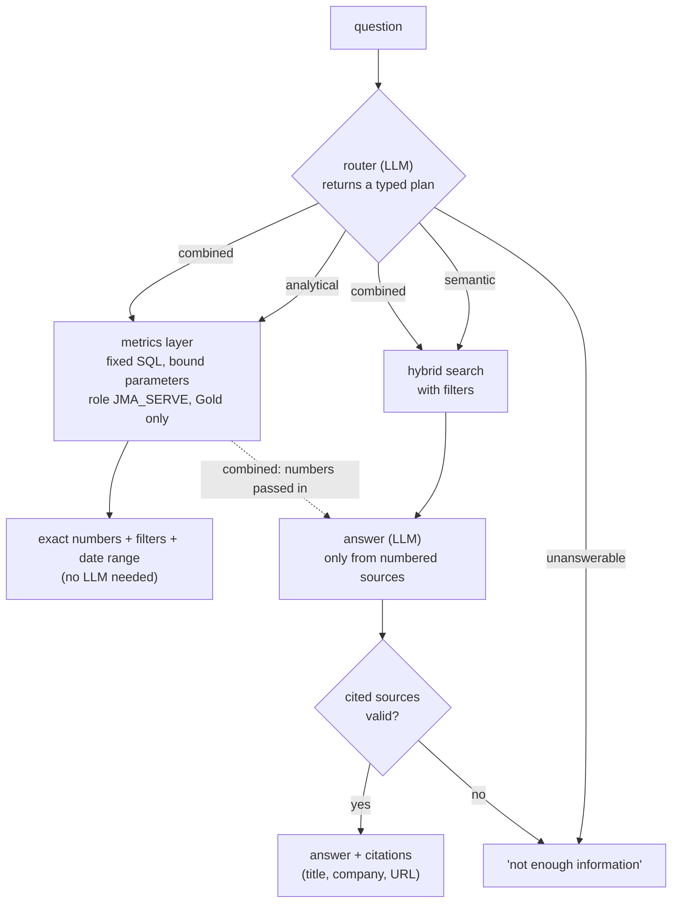

# API

The assistant is an HTTP API built with FastAPI. It runs on your machine (Q4).

| | |
|---|---|
| **Requirements** | FR-QA-01 to FR-QA-06, FR-QA-08/09, FR-API-01 to FR-API-05, FR-OBS-02, NFR-10, NFR-12, NFR-13 |
| **Decisions** | [ADR-0006](../decisions/0006-llm-provider-strategy.md) (models), [ADR-0008](../decisions/0008-metrics-layer-not-text-to-sql.md) (metrics layer), Q5 option C (resumes) |
| **Code** | `src/jobmarket/api/` (`app.py`, `assistant.py`, `metrics.py`, `match.py`, `logs.py`), `src/jobmarket/llm.py`, `src/jobmarket/skills.py` |

---

## Running it

```bash
make up        # vector database
make index     # build the index, if it isn't already
make api       # http://localhost:8000; interactive docs at http://localhost:8000/docs
```

Every endpoint except `/health` needs the header `X-API-Key: <API_KEY from .env>` (FR-API-05). The OpenAPI description is generated at `/openapi.json` from the same Pydantic models that validate every request and response (FR-API-02).

| Endpoint | Purpose | Uses a language model |
|---|---|---|
| `GET /health` | Warehouse, index and model checks | No |
| `POST /search` | Hybrid search with filters | No (embeddings only) |
| `POST /ask` | Answer a question, with route, citations and request ID (FR-API-03) | Yes |
| `GET /postings/{posting_key}` | One job: details, skills, status, change history (US-10) | No |
| `POST /match` | Best-matching open roles for a resume, and the skills it's missing | No |

## How `/ask` answers



| Route | Example | What answers it |
|---|---|---|
| Analytical | "Which 10 skills are most requested for analytics engineers in Bengaluru?" | `top_skills` over 23 jobs: SQL (22), Data modeling (17), Python (16), dbt (16), Snowflake (15); filters and date range stated (FR-QA-04) |
| Semantic | "What do employers mean by strong Kafka experience?" | Retrieved requirements sections from Capco, UST, Cisco and ICE postings, cited [1]–[4] |
| Combined | "How many remote roles mention LangChain, and what are some examples?" | `count_jobs` gives 4, then examples from the matching postings, cited |
| Unanswerable | "What is the average salary for prompt engineers on Mars?" | Declined: no salary data, and the location is outside the data (US-12) |

**Grounding (FR-QA-03, FR-QA-05).** The answering model sees numbered sources ([S1], [S2], …), one per posting. It must reply with the sources it used and say whether they were sufficient. Citations are then built **by code** from the postings actually retrieved: a source number the model invents is dropped. If the model says the evidence is insufficient, or cites nothing valid, the answer is "I don't have enough information…".

**Safety (NFR-13).** The model never writes SQL ([ADR-0008](../decisions/0008-metrics-layer-not-text-to-sql.md)). Hostile plans ("drop table …", injected `sql` fields, "ignore previous instructions…") are tested in `tests/test_api.py`.

## `/match`: resumes (Q5 option C)

1. The uploaded PDF or text is read in memory.
2. Skills are found **locally** with the same dictionary and whole-word rule as the dbt model.
3. Open jobs (optionally filtered by title words and city) are scored by the share of their skills the resume has. Jobs mentioning fewer than 3 skills are skipped.
4. Gaps are the skills most often asked for in those jobs that the resume doesn't mention.

No model is called and nothing from the resume is stored or logged. Only the request's latency is logged (NFR-10, tested).

Example: a short data engineer resume (Python, SQL, AWS, Airflow, dbt, Spark…), filtered to Hyderabad data engineer roles. Of 270 open jobs, the top matches have 5 of their 6 listed skills ("missing: Snowflake"). The top gaps are ETL and ELT (69% of jobs), data modeling (66%) and data quality (58%).

## Models (FR-QA-08)

All model calls go through `jobmarket/llm.py`. Switching is configuration only:

```bash
LLM_PROVIDER=groq      # default: openai/gpt-oss-120b, fastest
LLM_PROVIDER=gemini    # gemini-3.5-flash-lite
LLM_PROVIDER=ollama    # llama3 locally; LLM_MODEL=gemma2:9b for the other local model
```

Rate-limit responses (429) are retried with backoff (NFR-27). Groq's free tier allows 8,000 tokens a minute, and one question uses about 2,700 (router plus answer). Bursts of more than about three questions a minute therefore wait for the quota instead of failing.

## Request log (FR-OBS-02)

Every request writes a row to `public.api_requests` in the vector database: request ID, endpoint, route, status, latency, provider, model, tokens, and the **paid-tier equivalent** cost. Free-tier use costs nothing (NFR-08); the equivalent shows what a paid tier would cost. The question text is logged for `/ask` and `/search`, never for `/match`.

## Serving from Snowflake

Set `SERVING_WAREHOUSE=snowflake` and the API and index builder read Gold from Snowflake as `JMA_SERVE`. Every Snowflake connection turns secondary roles off, so the serving role really is read-only on Gold; see [Running on Snowflake](../pipeline/snowflake.md#secondary-roles).
